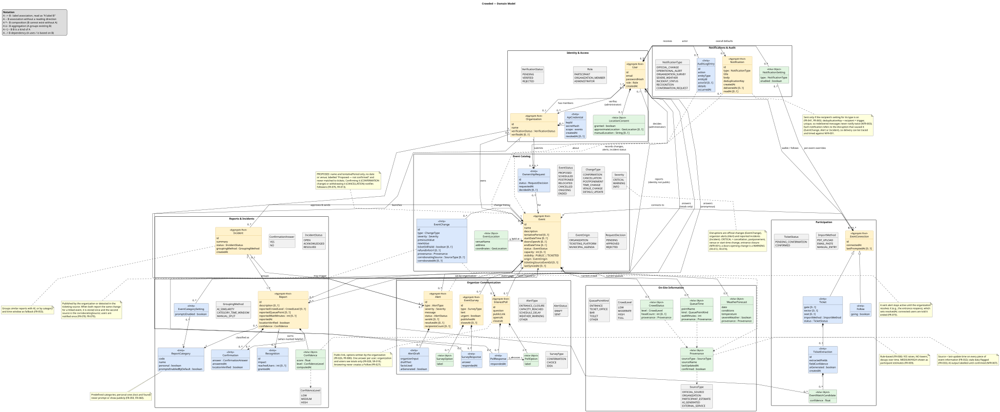

# Crowded

Project developed for the LABDSOF (Software Development Laboratory) course, part of the Master's Degree in Informatics Engineering – Software Engineering, during the first semester of the 2026/2027 academic year.

Crowded keeps people informed when something changes or goes wrong at the events they attend, and gives organizations an app for their audience without building one: they register their events, announce changes and redirect people on site. Participants connect with a ticket bought on any platform, or with the access code of a free public event. Crowded does not sell tickets.

## Team

| Student Number | Name               | Role                              |
|-----------------|-------------------|-----------------------------------|
| 1191256         | André Reis        | Scrum Master / Product Owner      |
| 1201506         | Guilherme Cunha   | Project Manager                   |
| 1211105         | Margarida Pereira | QA                                |
| 1250491         | Acácio Coutinho   | UI/UX                             |

## Documents

- [Assignment](/docs/LABDSOF-26-27-Assignment.md)
- [Problem and Opportunity Report](/docs/deliverables/problem-and-opportunity-report.md)
- [Market and Competitor Analysis Report](/docs/deliverables/market-and-competitor-analysis-report.md)
- [User Research](/docs/deliverables/user-research.md)
- [Product Vision](/docs/deliverables/product-vision.md)
- [Responsible AI Opportunity Assessment](/docs/deliverables/responsible-ai-opportunity-assessment.md)
- [Ethical Engagement Design](/docs/deliverables/ethical-engagement-design.md)
- [Requirements Specification](/docs/deliverables/requirements.md)
- [Product Backlog](/docs/deliverables/product-backlog.md)
- [Sprint 1 Scope](/docs/deliverables/sprint-1-scope.md)
- [Work Methodology](/docs/deliverables/work-methodology.md)
- [Operating Costs Estimation](/docs/deliverables/operating-costs.md)
- [Security and Privacy Assessment](/docs/deliverables/security-and-privacy-assessment.md)
- [Definition of Ready and Definition of Done](/docs/deliverables/definition-of-ready-and-done.md)
- [Technical Design](/docs/deliverables/technical-design.md)
- [Architecture Decision Records](/docs/deliverables/adr/)
- [API Outline](/docs/deliverables/api-outline.md)
- [Asynchronous Flows](/docs/deliverables/asynchronous-flows.md)
- [AI Usage](/docs/deliverables/ai-usage.md)

## Tech Stack

| Part | Technology |
|---|---|
| Backend services (`core/`, `jobs/`, `notifications/`) | Java 25 (JDK 25), latest stable Spring Boot (4.1.2), Maven |
| Data and messaging | PostgreSQL with Flyway migrations (`database/`), RabbitMQ, Redis |
| Participant app (`participant-app/`) | Flutter |
| Backoffice (`backoffice/`) | React, Vite and Tailwind CSS |

The reasons are in [ADR 0006](/docs/deliverables/adr/0006-technology-stack.md) and the other [Architecture Decision Records](/docs/deliverables/adr/).

## Domain Model



The domain model shows the main concepts of Crowded and how they relate, independently of how they are stored or deployed.

- **Event** is the centre of the model. Its organization registers it, owns it and is the only source of its changes, on-site information, alerts and surveys. Participants connect to it through a **Ticket** (for a ticketed event) or an **AccessCodeConnection** (for a public event), and only connected participants see it. Participants report what they see.
- **Aggregate roots** (yellow) mark consistency boundaries: each one is created and changed as a unit, and other parts of the model refer to it rather than changing it directly.
- **Provenance** is attached to every piece of event information, so the product can always show where it came from and when it was last updated.
- **Disruptions** take four forms: official changes (**EventChange**, published by the organization), organizer alerts (**Alert**), IPMA weather warnings (**WeatherWarning**) and incidents reported by participants (**Incident**). Changes, alerts and warnings share a **Severity** (critical, warning, information), alerts stay active until the organization resolves them, and every **Notification** points to the disruption that caused it.
- Integration details (weather snapshots, external providers) are kept out of the model; they belong to the services described in the [Technical Design](/docs/deliverables/technical-design.md).

Why each aggregate root is a boundary, and which journey of the [Product Vision](/docs/deliverables/product-vision.md#principal-user-workflows) it serves:

| Area | Aggregate root | Why it is its own consistency boundary | Workflow |
|---|---|---|---|
| Identity & Access | **User** | A person's account, role and location consent change together, and deleting it must remove their personal data in one step (FR-042) | All |
| Identity & Access | **Organization** | Created by a platform administrator with its members, it decides what they may publish (SR-001, SR-002); members refer to it, not the reverse | 3 |
| Event Catalog | **Event** | Its status, location and crowd status must always agree, and every change is recorded as an EventChange inside it, so the history cannot drift from the event | 1, 2, 3 |
| Participation | **EventConnection** | A Ticket or an access-code connection belongs to one participant and one event, is created or removed as a unit, and is what gives access to the event (SR-020); the ticket's extraction only exists through it | 1, 2 |
| Organizer Communication | **Alert**, **EventSurvey** | Each is drafted, published and closed on its own schedule, with its options and responses | 3 |
| Reports & Incidents | **Report**, **Incident** | A report and its confirmations decide its confidence together. An Incident groups many reports but is acknowledged and resolved separately, so reports are referenced, not owned. | 4 |
| Notifications & Audit | **Notification** | Delivered once per user and cause (NFR-003), with its own read and delivery state, independent of the event that caused it | 2 |

On-site information (crowd status, queue times, weather forecasts, provenance) are value objects: they are replaced, never edited, and have no identity of their own. The [Data Model](/docs/deliverables/technical-design.md#data-model) maps each concept to tables, and the [Asynchronous Flows](/docs/deliverables/asynchronous-flows.md) show how aggregates owned by different services stay consistent through messages.


Note: everyone's role is flexible and can change according to the needs of the project and everyone's assumed as developer as well.

## Getting Started

The scripts in [`scripts/local/`](/scripts/local/) prepare a clone and run Crowded on your machine: each `.sh` script (Debian, macOS) has a `.ps1` twin with the same options (Windows 11, PowerShell 7.4 or later). They read their configuration from `.env`, never print a secret, and publish ports on `127.0.0.1` only.

1. Install Docker (Docker Desktop on macOS and Windows) and Git, then run the setup once:

   ```bash
   scripts/local/setup.sh        # Windows: scripts\local\setup.ps1
   ```

   It checks the other tools and versions the projects need (JDK 25 as `JAVA_HOME`, Node.js 22.12 or later, Flutter 3.47, Lefthook 2, and gitleaks 8.30.1 or Docker) and says how to install any that is missing. It creates `.env` from [`.env.example`](/.env.example), with a new random value for every secret, and installs the [Git hooks](#git-hooks). It never overwrites an existing `.env`, which is git-ignored.

2. Run the whole system, as the production environment runs it, or one app from source:

   ```bash
   scripts/local/stack-up.sh     # the whole system: http://localhost:8080/
   scripts/local/infra-up.sh     # or only PostgreSQL, RabbitMQ and Redis...
   scripts/local/start.sh core   # ...and an app from source
   ```

| Script | What it does |
|---|---|
| `setup` | Checks the tools, creates `.env`, runs `lefthook install` |
| `stack-up [--pull] [--with-observability]` | Turns on single-node Docker Swarm, builds every image from the working copy (`--pull`: the Docker Hub images tagged `main`), creates the secrets from `.env` and deploys [`deployment/docker-compose.swarm.yml`](/deployment/docker-compose.swarm.yml) with a local override: the database is migrated and seeded with the demo data. A gateway serves it on `http://localhost:8080/` (backoffice on `/backoffice/`, API on `/api/`) and forwards PostgreSQL, RabbitMQ and Redis. Run again over a running stack, it moves only the services whose image changed, each image being tagged `local-<image id>`, and waits until every service is healthy and none is still updating. `--with-observability` adds Prometheus, Loki, Alloy and Grafana, on `http://localhost:8080/grafana/` (user `admin`, password `GRAFANA_ADMIN_PASSWORD` of `.env` or `admin`). On Windows: `-Pull`, `-WithObservability` |
| `stack-down` | Removes the stack, its data and its secrets. Swarm stays on |
| `infra-up`, `infra-down` | Start or remove PostgreSQL (migrated and seeded, data in memory), RabbitMQ and Redis alone |
| `start <app>`, `stop <app>` | Run `core`, `jobs`, `notifications`, `backoffice` or `participant-app` from source in the background, with its configuration from `.env`; its log goes to `.local/logs/<app>.log` |
| `status` | The state and health of every service, of the infrastructure and of the apps run from source |
| `logs <service>` | Follows one service's log, e.g. `logs core` |
| `reset-db` | Drops the database and creates it again, migrated and seeded |

The ports are in `.env`: `HTTP_PORT` (8080), `DB_PORT` (5432), `RABBITMQ_PORT` (5672), `REDIS_PORT` (6379), and for the apps run from source `CORE_PORT` (8081), `JOBS_PORT` (8082), `NOTIFICATIONS_PORT` (8083), `BACKOFFICE_PORT` (5173) and `PARTICIPANT_APP_PORT` (8090). The stack and the infrastructure use the same ports, so only one of them runs at a time; `start` works with either. Running any script twice in a row is safe.

With the stack running, `node scripts/ci/test-journeys.mjs` (Node 22 or later) checks the principal journeys across the apps' APIs with the demo accounts: real sign-in, a participant and another organization's member refused, an event created, connections by access code and by ticket, crowd level, queue times and alerts seen by both sides, and the change and alert notifications reaching the connected participants. It creates and cancels an event and sends an alert to Festival Margens do Douro, so it takes another API's address as an argument only for a test environment, never one with real participants.

Each project's README has a **Setup** section: what it needs, what it reads from `.env`, how to run it alone and how to test it. See [`core/`](/core/README.md#setup), [`jobs/`](/jobs/README.md#setup), [`notifications/`](/notifications/README.md#setup), [`backoffice/`](/backoffice/README.md#setup), [`participant-app/`](/participant-app/README.md#setup) and [`database/`](/database/README.md#setup). Deployed environments take their configuration from Doppler instead of `.env` ([`deployment/`](/deployment/README.md)).

## Contributing

### Commit Messages

All commits must follow the [Conventional Commits](https://www.conventionalcommits.org/en/v1.0.0/) convention and reference the corresponding GitHub issue:

```
[fix|docs|chore|feat](#IssueNumber): message
```

Example:

```
fix(#10): raccoon now steals food with success
```

### Naming Conventions

- File names should be descriptive and use `kebab-case` and/or `camelCase`.

### Git Hooks

The repository has one set of Git hooks for all projects, configured in [`lefthook.yml`](/lefthook.yml) and run by [Lefthook](https://lefthook.dev). [`scripts/local/setup.sh`](#getting-started) checks these tools and installs the hooks; by hand:

1. Install [Lefthook](https://lefthook.dev/installation/) 2.x, for example `npm install -g lefthook`, `brew install lefthook` or `winget install evilmartians.lefthook`.
2. Install [gitleaks 8.30.1](https://github.com/gitleaks/gitleaks#installing), or have Docker running: [`scripts/gitleaks.sh`](/scripts/gitleaks.sh) uses the `zricethezav/gitleaks:v8.30.1` image, the one the Security workflow uses, when gitleaks 8.30.1 is not installed.
3. Install each project's own tools (JDK 25 as `JAVA_HOME` for the backend, Node.js, Flutter) and dependencies (`npm install` in `backoffice/`, `flutter pub get` in `participant-app/`).
4. Run `lefthook install` at the repository root.

On Windows, Lefthook runs the hooks with the shell of Git for Windows, and `scripts/gitleaks.sh` hands over to its PowerShell twin, [`scripts/gitleaks.ps1`](/scripts/gitleaks.ps1), so PowerShell 7 must be on `PATH` as `pwsh`.

| Hook | What it does |
|---|---|
| `pre-commit` | Formats the staged files of each project with its formatter and stages the result, then runs `gitleaks git --pre-commit --staged --redact` on the staged changes. |
| `pre-push` | Runs the lint command of each project changed in the pushed commits, then gitleaks on those commits. Any failure blocks the push. |

`git commit --no-verify` and `git push --no-verify` skip the hooks. The pipeline (#69) runs the same checks, so skipping them only delays the failure.

### Pull Requests

Every change reaches `main` through a pull request that follows the [template](.github/pull_request_template.md), passes the required checks and is approved by another team member (DoD-02). Pull requests are merged by **rebase** only, the branch must be up to date with `main`, and the merged branch is deleted. After the merge, `main` runs the checks again and only then builds and pushes the images ([ADR 0011](docs/deliverables/adr/0011-ci-pipeline-and-vulnerability-policy.md#images-on-main)).

Dependabot's pull requests approve and merge themselves once their checks pass, and are asked to rebase when they fall behind `main`. If Dependabot does not respond, the workflow tags the team in the pull request: comment `@dependabot rebase` there ([ADR 0011](docs/deliverables/adr/0011-ci-pipeline-and-vulnerability-policy.md#dependabot)).

### Format and Lint Commands

Run them from the project's folder. The format check fails and names the unformatted files.

| Project | Format | Format check | Lint | Tests |
|---|---|---|---|---|
| `core/`, `jobs/`, `notifications/` | `./mvnw spotless:apply` | `./mvnw spotless:check` | `./mvnw test-compile` | `./mvnw verify` |
| `backoffice/` | `npm run format` | `npm run format:check` | `npm run lint` | `npm run test:coverage` |
| `participant-app/` | `dart format lib test` | `dart format --output=none --set-exit-if-changed lib test` | `flutter analyze --fatal-infos` | `flutter test` |

- Backend: Spotless with google-java-format, and the compiler with `-Xlint:all` and `failOnWarning` as lint, so any warning fails. `./mvnw verify` runs the unit tests with the JaCoCo coverage check, the integration tests (Testcontainers, so Docker must be running), SpotBugs and `spotless:check`. Maven must run on JDK 25 (`JAVA_HOME`).
- Backoffice: Prettier and oxlint (`.oxlintrc.json`). `npm run test:coverage` fails below 80% line coverage.
- Participant app: `dart format` and `flutter analyze` (`analysis_options.yaml`).
- CI runs the same checks per app (`.github/workflows/`), in the order and with the vulnerability policy of [ADR 0011](/docs/deliverables/adr/0011-ci-pipeline-and-vulnerability-policy.md).
- Secret scan of the whole history, as the Security workflow does it: `scripts/gitleaks.sh git --redact --verbose` from the repository root.
- [`.editorconfig`](/.editorconfig) sets UTF-8, LF line endings and indentation for editors, and [`.gitattributes`](/.gitattributes) keeps LF line endings in the repository.
