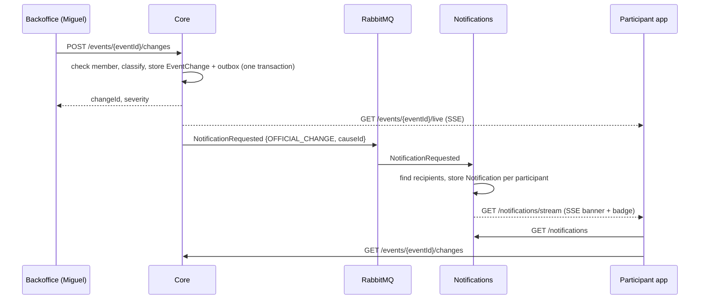

# Asynchronous Flows

This document describes how an official event change travels from the organization's backoffice to the notified participants, how an IPMA weather warning reaches them, and what happens when a step fails. It builds on the [Technical Design](technical-design.md), the [ADRs](adr/), the [API Outline](api-outline.md) and the BPMN workflow [Official change notification](bpmn/workflow-2-official-change-notification.bpmn).

## 1. Rules

- Core, Jobs and Notifications do not call each other. Everything between them goes through RabbitMQ ([ADR 0001](adr/0001-three-backend-services.md), [ADR 0003](adr/0003-rabbitmq-for-asynchronous-messaging.md), TR-003).
- Messages carry ids only, and the consumer reads the current data from the database. The only exception is `ReportsGrouped` ([API Outline: Messages](api-outline.md#messages)).
- Only the owning service writes a table ([ADR 0002](adr/0002-shared-database-with-table-ownership.md)). Jobs reports what it fetched from IPMA, and Core applies it.
- Delivery is at least once, so every consumer is idempotent (NFR-003). A message is acknowledged only after its effects are committed.
- Failed messages are retried with backoff, then moved to a dead-letter queue (NFR-004).
- Every request and message carries a correlation id, which appears in every log line it causes (NFR-010).

## 2. Messages

The messages are defined in the [API Outline](api-outline.md#messages). The two flows below use these:

| Message | Publisher → Consumer | Payload | Effect |
|---|---|---|---|
| `NotificationRequested` | Core → Notifications | `messageId`, `type`, `eventId`, `causeId`, `userIds[]` | Notifications notifies the connected participants, or only `userIds` when given. |
| `WeatherUpdated` | Jobs → Core | `district`, `snapshotId` | Core stores the forecast and warnings and, for a new or raised orange or red warning, publishes `NotificationRequested`. |

All messages go through one topic exchange, `crowded.events`. The routing key is the message name in dotted lower case, such as `notification.requested`. The body is the payload as JSON, persistent, with `messageId` also as the AMQP message id. Each consumer declares its own durable queue, bound to the routing keys it consumes, and its dead-letter queue.

**Retries.** A failed message is retried after 5 s, 15 s and 30 s, so all retries end within 1 minute. After that, it goes to the queue's dead-letter queue (`<queue>.dlq`). A non-empty DLQ raises an alert in Grafana. Messages can be replayed from the DLQ after the cause is fixed, which is safe because consumers are idempotent.

**Outbox.** Core and Jobs write each outgoing message to an outbox table in the same transaction as the change; Core's is `outbox` ([Data Model](diagrams/data-model.svg)), and Jobs gets its own when it publishes, since each table has one writer (ADR 0002). A relay polls it every half second, publishes the oldest messages first, and deletes each one once RabbitMQ confirms it, keeping the same `messageId` if it has to publish it again. If RabbitMQ is down, the message waits in the outbox, so no change is lost. Rows locked by one Core replica's relay are skipped by the others.

## 3. Official change flow



### Step 1: Publication (Core)

1. A member of the organization that owns the event publishes the change: postpone, move, cancel, or change the time or doors opening time (FR-016, FR-072, SR-001). For a cancellation or postponement, the member says whether tickets stay valid and where to ask for a refund (FR-075).
2. Compare the new values with the current event. If nothing differs, return the existing change without storing a new one. This happens when the backoffice resends a request.
3. Classify the change by type and severity, e.g. a cancellation is critical (FR-074).
4. In one transaction, store the `EventChange`, update the event, and write `NotificationRequested` to the outbox with `type = OFFICIAL_CHANGE` and `causeId` = the `EventChange` id. Audit who published it (SR-006).
5. Invalidate the event cache in Redis (TR-006) and send the update on `GET /events/{eventId}/live`.

A last-minute cancellation follows two paths: the organization first sends an operational alert, which is faster to write, and then publishes the cancellation with its refund information through this flow.

### Step 2: Notification (Notifications)

1. Find the participants connected to the event (through a ticket or the access code) who have official changes turned on (FR-041, FR-065).
2. Store one `Notification` per participant. The `deduplicationKey` is the participant plus the message's `messageId`, and it is unique. A notification that already exists is skipped.
3. Send each new notification on `GET /notifications/stream`, as a live banner with the updated unread count (FR-068).
4. Later, when push is added, send it to the mobile app through FCM (FR-069, [ADR 0010](adr/0010-external-integrations.md)). Push is retried on its own, per notification, so a retry never depends on `NotificationRequested` being delivered again.

The participant opens the notification center (`GET /notifications`) and the change (`GET /events/{eventId}/changes`), which says what changes for them: the new date or venue, whether the ticket is still valid, and where to ask for a refund (FR-075). Without failures, the whole flow, from publication to delivery, takes under 1 minute (NFR-001).

## 4. Weather warning flow

This is the flow of the external integration: IPMA is a real public source, outside Crowded's control.

```mermaid
sequenceDiagram
    participant I as IPMA
    participant J as Jobs
    participant MB as RabbitMQ
    participant C as Core
    participant N as Notifications

    J->>I: GET warnings_www.json (every 5 min)
    J->>I: GET cities/daily/{globalIdLocal}.json (forecasts)
    J->>J: validate, keep the districts of upcoming events, compare with last snapshot
    J->>MB: WeatherUpdated {district, snapshotId}
    MB->>C: WeatherUpdated
    C->>C: store forecast and WeatherWarning per event; new or raised orange/red?
    C->>MB: NotificationRequested {WEATHER_WARNING, causeId}
    MB->>N: NotificationRequested
```

1. Every 5 minutes, Jobs fetches the IPMA warnings, with a 10 s timeout, and every hour the forecast of the district capital of each district with an upcoming event. This keeps detection within 10 minutes (NFR-021).
2. Jobs validates the data, rejects and logs what is invalid (NFR-005), and keeps only the warning areas of districts with an upcoming or ongoing event.
3. When a district's warnings or forecast differ from its last snapshot (content hash), Jobs stores a new snapshot and publishes `WeatherUpdated`. Jobs owns the snapshots ([Technical Design](technical-design.md#logical-view-level-2)).
4. Core stores the forecast and the warnings for every event in that district, labelled with IPMA as source (FR-032), and updates the event page over SSE.
5. For a warning that is new or raised to orange or red and overlaps the event's time, Core publishes `NotificationRequested` with `type = WEATHER_WARNING` (FR-036). A red warning is critical, an orange one a warning (FR-074). Yellow warnings appear on the event page without a notification.
6. Notifications then follows Step 2 of the official change flow.

## 5. Failures and degraded mode

| Failure | Retry | What users see |
|---|---|---|
| IPMA unavailable | 3 attempts in the same run (1 s, 2 s, 4 s), then again on the next run | The last valid forecast and warnings with their time (NFR-005). |
| IPMA returns invalid data | None. The data is rejected and logged. | The last valid data for that district. Other districts keep updating. |
| RabbitMQ unavailable | Messages wait in the outbox until it is back | The change on the event page; notifications arrive late. |
| Database unavailable | Publishing a change fails and the backoffice shows the error; the IPMA run and the messages fail and are retried, and messages that still fail go to the DLQ. Docker Swarm restarts the database container ([Technical Design](technical-design.md#deployment-view)). | Errors on requests until the database is back. Warnings are detected and notified late. |
| Core fails processing `WeatherUpdated` | 5 s, 15 s, 30 s, then DLQ | The old weather data and no warning notification until the retry succeeds or the message is replayed from the DLQ. Nothing is applied twice. |
| Notifications fails processing `NotificationRequested` | 5 s, 15 s, 30 s, then DLQ | The change on the event page. The notification arrives after the retry succeeds or the message is replayed from the DLQ. No one is notified twice. |
| Notifications fails after storing a notification and before sending it on the stream | The retry skips it, because its `deduplicationKey` already exists | No live banner for that notification. It is in the notification center, and the unread badge is updated when the client reloads `GET /notifications` (FR-067). |
| Push provider unavailable (after push is added, [ADR 0010](adr/0010-external-integrations.md)) | Notifications retries each push with backoff and never sends it twice. Failures are logged and shown in Grafana. | The notification in the notification center and as a live banner, without push (NFR-020). |
| App closed or offline | None needed | All missed notifications in `GET /notifications` when the app reopens (FR-067). |

The push provider failure is the scenario shown in the final presentation ([Degraded Operation](technical-design.md#degraded-operation)).

## 6. Idempotency

| Step | If the same input arrives twice |
|---|---|
| Publication resent by the backoffice | The event already has the new values, so no new `EventChange` is stored. |
| Weather detection | The content hash is unchanged, so no new snapshot or message is created. |
| Weather storage | The warning is already stored at that level, so no new notification is requested. |
| Notification | The `deduplicationKey` (user + `messageId`) already exists, so no second notification, banner or push is sent (NFR-003). |

## 7. Vertical Slice

The [Vertical Slice](api-outline.md#vertical-slice) of Sprint 2 implements the official change flow end to end on top of the walking skeleton, with ticket import and the event-code fallback. It covers:

| Step | Interface | This document |
|---|---|---|
| 1. A member of the organization registers a ticketed event | `POST /events` | – |
| 2. The participant imports a ticket and is connected | `POST /tickets` | Creates the connection used to find recipients (§3, Step 2.1) |
| 3. The member publishes a change | `POST /events/{eventId}/changes` | §3, Step 1 |
| 4. Notifications notifies the participant | `NotificationRequested` (`OFFICIAL_CHANGE`) | §3, Step 2 |
| 5. The open app shows a live banner and updates the badge | `GET /notifications/stream` | §3, Step 2 |
| 6. The participant opens the notification center and the change | `GET /notifications`, `POST /notifications/{notificationId}/read`, `GET /events/{eventId}/changes` | §3, Step 2 |
| 7. IPMA issues a warning for the event's district | `WeatherUpdated`, `NotificationRequested` (`WEATHER_WARNING`) | §4 |
| 8. Each service reports its health | Health check of each service (NFR-011) | – |

The slice must include the retries, the DLQs, the outbox and the `deduplicationKey`, so that the failure and idempotency behaviour in §5 and §6 can be tested from the start. The outbox cannot be left out: without it, a service that commits a change and stops before publishing loses the message, and the retry finds nothing to do.

## 8. Other asynchronous flows

These flows use the same rules, retries and deduplication ([API Outline: Messages](api-outline.md#messages)).

| Flow | Path |
|---|---|
| Alert sent or resolved, urgent survey, confirmation request, incident status, recognition | Core → `NotificationRequested` (`OPERATIONAL_ALERT`, `ORGANIZATION_SURVEY`, `CONFIRMATION_REQUEST`, `INCIDENT_STATUS`, `RECOGNITION`) → Notifications |
| Report grouping | Core → `ReportSubmitted` → Jobs → `ReportsGrouped` → Core. Without AI, Jobs groups by category and time window (FR-053). |
| Account deletion | Core → `UserDeleted` → Notifications deletes the user's notifications, settings and device tokens (FR-042) |
