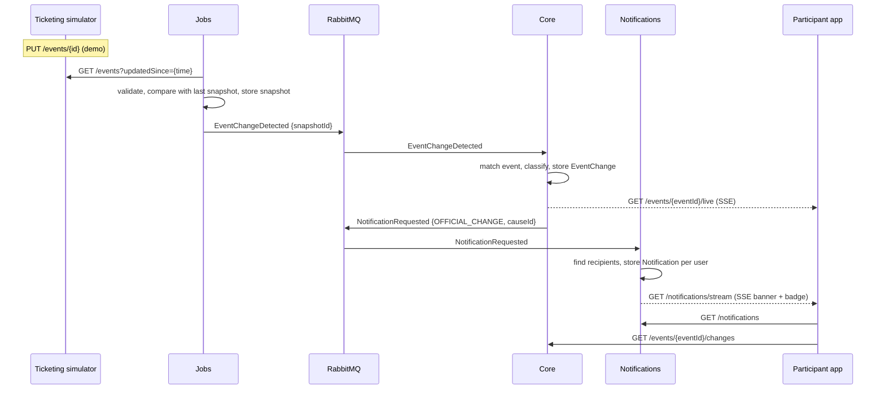

# Asynchronous Flows

This document describes how an official event change travels from the ticketing source to the notified users, and what happens when a step fails. It builds on the [Technical Design](technical-design.md), the [ADRs](adr/), the [API Outline](api-outline.md) and the BPMN workflow [Official change notification](bpmn/workflow-2-official-change-notification.bpmn).

## 1. Rules

- Core, Jobs and Notifications do not call each other. Everything between them goes through RabbitMQ ([ADR 0001](adr/0001-three-backend-services.md), [ADR 0003](adr/0003-rabbitmq-for-asynchronous-messaging.md), TR-003).
- Messages carry ids only, and the consumer reads the current data from the database. The only exception is `ReportsGrouped` ([API Outline: Messages](api-outline.md#messages)).
- Only the owning service writes a table ([ADR 0002](adr/0002-shared-database-with-table-ownership.md)). Jobs reports a change, and Core applies it.
- Delivery is at least once, so every consumer is idempotent (NFR-003). A message is acknowledged only after its effects are committed.
- Failed messages are retried with backoff, then moved to a dead-letter queue (NFR-004).
- Every request and message carries a correlation id, which appears in every log line it causes (NFR-010).

## 2. Messages

The messages are defined in the [API Outline](api-outline.md#messages). The official change flow uses two of them:

| Message | Publisher → Consumer | Payload | Effect |
|---|---|---|---|
| `EventChangeDetected` | Jobs → Core | `snapshotId`, `ticketingSourceEventId` | Core adds the event to the catalog or records the change. |
| `NotificationRequested` | Core → Notifications | `messageId`, `type`, `eventId`, `causeId`, `userIds[]` | Notifications notifies the connected users, or only `userIds` when given. |

All messages go through one topic exchange, `crowded.events`. Each consumer has its own durable queue.

**Retries.** A failed message is retried after 5 s, 15 s and 30 s, so all retries end within 1 minute. After that, it goes to the queue's dead-letter queue (`<queue>.dlq`). A non-empty DLQ raises an alert in Grafana. Messages can be replayed from the DLQ after the cause is fixed, which is safe because consumers are idempotent.

**Outbox.** Core and Jobs write each outgoing message to an `outbox` table in the same transaction as the change. A relay then publishes it, keeping the same `messageId` if it has to publish it again. If RabbitMQ is down, the message waits in the outbox, so no change is lost.

## 3. Official change flow

### Step 1: Detection (Jobs)

1. Every minute, call the simulator's `GET /events?updatedSince={time}`, with a 10 s timeout. `time` is the start of the last successful sync, so a failed run loses no change. This keeps detection within 5 minutes (NFR-002).
2. Validate each event. Reject and log invalid events (NFR-005).
3. Compare each valid event with its last snapshot (content hash). If it is unchanged, do nothing.
4. If it changed, store a new snapshot and publish `EventChangeDetected`.
5. Record the time of the successful sync in the sync snapshots, which Jobs owns ([Technical Design](technical-design.md#logical-view-level-2)). This happens on every successful run, even when nothing changed. Core reads it (allowed by [ADR 0002](adr/0002-shared-database-with-table-ownership.md)) and returns it as `lastSyncedAt` on `GET /events/{eventId}`.

### Step 2: Storage (Core)

1. Read the snapshot and match it to the event by `ticketingSourceEventId` (FR-079). A new source event is added to the catalog, without a notification.
2. Check whether the other source already recorded this change: an `EventChange` of the same event and type, with `provenanceSourceType = ORGANIZATION` and no corroborating source yet (FR-078, [Data Model](technical-design.md#data-model)).
   - **Same values:** set `corroboratingSourceType = OFFICIAL_SOURCE` and `corroboratedAt` on it, and stop. No second notification is sent.
   - **Different values:** record the conflict, which the organization sees in `sourceConflicts[]`, and stop. Participants see both values with their sources.
3. Compare the snapshot with the current event. If nothing differs, stop. This happens when a message is processed twice.
4. Classify the change by type and severity, e.g. a cancellation is critical (FR-074).
5. Store the `EventChange` and update the event in one transaction, and publish `NotificationRequested` with `type = OFFICIAL_CHANGE` and `causeId` = the `EventChange` id.
6. Invalidate the event cache in Redis (TR-006) and send the update on `GET /events/{eventId}/live`.

A change published by the organization through `POST /events/{eventId}/changes` follows steps 2 to 6 in the HTTP request, with the sources swapped: in step 2, Core looks for an `EventChange` from `OFFICIAL_SOURCE`. The response says whether the change was `corroborated` ([API Outline](api-outline.md#3-get-notified-of-changes)).

### Step 3: Notification (Notifications)

1. Find the users connected to the event (ticket holders and followers) who have official changes turned on (FR-041, FR-065).
2. Store one `Notification` per user. The `deduplicationKey` is the user plus the message's `messageId`, and it is unique. A notification that already exists is skipped.
3. Send each new notification on `GET /notifications/stream`, as a live banner with the updated unread count (FR-068).
4. Later, when push is added, send it to the mobile app through FCM (FR-069, [ADR 0010](adr/0010-external-integrations.md)). Push is retried on its own, per notification, so a retry never depends on `NotificationRequested` being delivered again.

The participant opens the notification center (`GET /notifications`) and the change (`GET /events/{eventId}/changes`), which says what changes for them: the new date or venue, whether the ticket is still valid, and where to ask for a refund (FR-075). Without failures, the whole flow, from detection to delivery, takes under 1 minute (NFR-001).

## 4. Failures and degraded mode

| Failure | Retry | What users see |
|---|---|---|
| Ticketing source unavailable | 3 attempts in the same sync run (1 s, 2 s, 4 s), then again on the next run | The last valid data and the time of the last successful sync, `lastSyncedAt` (NFR-005). |
| Ticketing source returns invalid data | None. The data is rejected and logged. | The last valid data for that event. Other events keep syncing. |
| RabbitMQ unavailable | Messages wait in the outbox until it is back | The change on the event page; notifications arrive late. |
| Database unavailable | The sync run and the messages fail and are retried; messages that still fail go to the DLQ. Docker Swarm restarts the database container ([Technical Design](technical-design.md#deployment-view)). | Errors on requests until the database is back. Changes are detected and notified late. |
| Core fails processing `EventChangeDetected` | 5 s, 15 s, 30 s, then DLQ | The old event data and no notification until the retry succeeds or the message is replayed from the DLQ. Nothing is applied twice. |
| Notifications fails processing `NotificationRequested` | 5 s, 15 s, 30 s, then DLQ | The change on the event page. The notification arrives after the retry succeeds or the message is replayed from the DLQ. No one is notified twice. |
| Notifications fails after storing a notification and before sending it on the stream | The retry skips it, because its `deduplicationKey` already exists | No live banner for that notification. It is in the notification center, and the unread badge is updated when the client reloads `GET /notifications` (FR-067). |
| Push provider unavailable (after push is added, [ADR 0010](adr/0010-external-integrations.md)) | Notifications retries each push with backoff and never sends it twice. Failures are logged and shown in Grafana. | The notification in the notification center and as a live banner, without push (NFR-020). |
| App closed or offline | None needed | All missed notifications in `GET /notifications` when the app reopens (FR-067). |

The push provider failure is the scenario shown in the final presentation ([Degraded Operation](technical-design.md#degraded-operation)).

## 5. Idempotency

| Step | If the same input arrives twice |
|---|---|
| Detection | The content hash is unchanged, so no new snapshot or message is created. |
| Storage | The event already has the new values, so no new `EventChange` is stored. |
| Same change from organization and ticketing source | It is stored once, with both sources (FR-078). |
| Notification | The `deduplicationKey` (user + `messageId`) already exists, so no second notification, banner or push is sent (NFR-003). |

## 6. Walking Skeleton

The [Walking Skeleton](api-outline.md#walking-skeleton) implements this flow without ticket import, AI or push. It covers:

| Step | Interface | This document |
|---|---|---|
| 1. The participant signs up and signs in | `POST /auth/register`, `POST /auth/login` | – |
| 2. The participant finds the event and follows it | `GET /events`, `GET /events/{eventId}`, `POST /events/{eventId}/follow` | Creates the connection used to find recipients (§3, Step 3.1) |
| 3. The event changes in the simulator, and Jobs detects it | Simulator `PUT /events/{id}`, `GET /events?updatedSince={time}` | §3, Step 1 |
| 4. Core records the change | `EventChangeDetected` | §3, Step 2 |
| 5. Notifications notifies the follower | `NotificationRequested` (`OFFICIAL_CHANGE`) | §3, Step 3 |
| 6. The open app shows a live banner and updates the badge | `GET /notifications/stream` | §3, Step 3 |
| 7. The participant opens the notification center and the change | `GET /notifications`, `POST /notifications/{notificationId}/read`, `GET /events/{eventId}/changes` | §3, Step 3 |
| 8. Each service reports its health | Health check of each service (NFR-011) | – |

The skeleton must include the retries, the DLQs, the outbox and the `deduplicationKey`, so that the failure and idempotency behaviour in §4 and §5 can be tested from the start. The outbox cannot be left out: without it, a service that commits a change and stops before publishing loses the message, and the retry finds nothing to do (§3, Step 1.3 and Step 2.3). The corroboration with organization changes (§3, Step 2.2) can be added after the skeleton.

## 7. Other asynchronous flows

These flows use the same rules, retries and deduplication ([API Outline: Messages](api-outline.md#messages)).

| Flow | Path |
|---|---|
| Alert sent or resolved, urgent survey, confirmation request, incident status, recognition | Core → `NotificationRequested` (`OPERATIONAL_ALERT`, `ORGANIZATION_SURVEY`, `CONFIRMATION_REQUEST`, `INCIDENT_STATUS`, `RECOGNITION`) → Notifications |
| Severe weather | Jobs → `WeatherForecastFetched` → Core stores the forecast and, above the threshold, publishes `NotificationRequested` (`SEVERE_WEATHER`) |
| Report grouping | Core → `ReportSubmitted` → Jobs → `ReportsGrouped` → Core. Without AI, Jobs groups by category and time window (FR-053). |
| Account deletion | Core → `UserDeleted` → Notifications deletes the user's notifications, settings and device tokens (FR-042) |

## 8. Open points

- The [Data Model](diagrams/data-model.svg) does not yet include these tables, which the flows above need: sync snapshots with the time of the last successful sync (Jobs), `outbox` (Core and Jobs), `device_token` and notification settings (Notifications).
- `Event.lastSyncedAt` is a Core column, but only Jobs knows when a sync succeeded. Core returns the time from the sync snapshots (§3, Step 1.5), so the column can be removed or kept only as a cached copy.
