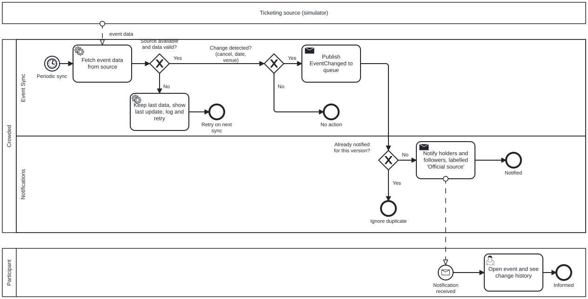

# Product Vision

## Vision Statement
Crowded keeps people informed when something changes or goes wrong at the events
they are attending. An event organization adopts Crowded instead of building and
running its own app: it registers its events in the backoffice, publishes changes,
on-site conditions and alerts, and handles what participants report. Participants
connect with their ticket, or with an access code for a free public event, and
learn in time what changed and what is happening on site, so that participants and
organizations can make decisions based on current and reliable information.

## Positioning
**Crowded does not sell tickets and is not where tickets are bought.** Ticketing
platforms (Ticketline, BOL, DICE, Eventbrite) handle the purchase; Crowded covers
what happens after it:

| Phase | Who serves it today | What Crowded does |
|---|---|---|
| **Purchase** | Ticketing platforms | Nothing: Crowded never sells, resells or links to tickets |
| **After the purchase, until the event ends**: what changed, what is happening at the venue now | Ticketing emails, social media, on-site staff, a festival's own app | Official changes from the organization, weather warnings, organizer alerts, crowd levels, queues and participant reports, each with its source and time |

**Who pays.** The organization. A festival or venue that wants an app for its
audience subscribes to Crowded instead of paying for its own app and
infrastructure. It gets the backoffice, and its participants get the app for free.
Crowded's platform administrators create each organization's accounts.

**How a participant gets in.** There is no event catalog, search or "near me" list.
A participant reaches an event's page only with a ticket for it (imported from the
PDF or a screenshot) or, for a free public event, with the access code that the
organization gives out.

## Personas

Inês is the primary persona: the north star metric measures how early she learns
about a disruption. Miguel and Rita are the two people at the organization who make
that possible: one before the event, one on the day.

**Why these three.** They cover the two sides of the stakeholder map
([Problem and Opportunity Report, section 4](problem-and-opportunity-report.md#4-stakeholder-map)):
the attendee, and the organization in its two moments, preparing the event and
operating it on the day. Each frustration comes from a documented problem or a
user-research finding, cited under **Basis**. Organizers were not part of the user
research ([its limitations](user-research.md#limitations)), so Miguel and Rita rest on
the problem evidence and on assumption A2. Interviews with organizers in Sprint 3
validate them ([Assumptions](problem-and-opportunity-report.md#5-assumptions)).

### Persona 1 — Inês, the Participant
- **Age/context:** 24 years old, university student in Porto
- **Goal:** keep track of the events she is going to (a festival bought on
  Ticketline, free public events like São João) without having to monitor ticketing
  sites, Instagram pages and emails for updates
- **Frustration:** she has already arrived at a cancelled event without knowing,
  and has faced overcrowded venues and long queues she could have avoided
- **How Crowded helps:** she imports her ticket or types a public event's access
  code, receives a notification when the event changes or a weather warning is
  issued, and checks crowd levels, queues and organizer alerts before leaving home.
  When the organizer has published nothing, she sees estimates reported and confirmed
  by other participants.
- **Basis:**
  - Changes spread across channels and arriving too late
    ([Problem Evidence 3.1](problem-and-opportunity-report.md#31-fragmented-communication-of-changes)).
  - Documented cases of audiences already at the venue when a show was cancelled, and of
    queues of over an hour ([3.6](problem-and-opportunity-report.md#36-documented-disruptions-in-portugal-and-europe)).
  - User research: alerts that never arrived, and tickets hard to reach while travelling
    ([Findings](user-research.md#summary-of-findings)).

### Persona 2 — Miguel, the Event Manager
- **Age/context:** 35 years old, production manager of a summer music festival in
  Porto
- **Goal:** tell everyone who holds a ticket, in time, when the festival changes:
  a new date, a stage moved to another venue, a cancelled day
- **Frustration:** announces changes on the ticketing platform, Instagram and the
  website, and never knows whether everyone was informed before leaving home.
  Building an app of their own was too expensive for a festival of this size.
- **How Crowded helps:** signs in with the account that Crowded's administrator
  created, registers the festival with its dates, doors opening time, venue and the
  event code printed on the tickets, and publishes any later change. Every ticket
  holder is notified within a minute with what changes for them, including where to
  ask for a refund.
- **Basis:**
  - Changes spread across channels
    ([3.1](problem-and-opportunity-report.md#31-fragmented-communication-of-changes)).
  - Ticketing platforms stop at the purchase
    ([3.2](problem-and-opportunity-report.md#32-ticketing-platforms-stop-at-the-purchase)).
  - Validated by assumption A2.

### Persona 3 — Rita, the Front-of-House Manager
- **Age/context:** 29 years old, front-of-house manager at the same festival
- **Goal:** keep the audience safe and moving on the day: entrances, queues,
  capacity and incidents
- **Frustration:** when an entrance closes or an area is full, she can only redirect
  people through staff at the gates and a social media post that few people see in
  time
- **How Crowded helps:** publishes crowd levels and queues through the backoffice,
  sends alerts such as "Gate B closed, use Gate C" to everyone connected to the event
  from an AI-generated draft she reviews, asks the audience quick questions through
  surveys, and handles similar participant reports as a single incident
- **Basis:**
  - No direct organizer-to-audience channel during events
    ([3.5](problem-and-opportunity-report.md#35-no-direct-organizer-to-audience-channel-during-events)).
  - No real-time on-site awareness
    ([3.3](problem-and-opportunity-report.md#33-lack-of-real-time-on-site-awareness)).
  - Validated by assumption A2.

Miguel and Rita are both members of the same organization in Crowded; they use the
same backoffice with the same permissions.

## Value Proposition
For organizations, Crowded is the app for their audience without building one: a
backoffice to register events, publish changes and on-site conditions, send alerts
and handle incidents, and an app their participants already know. For participants,
unlike ticketing platforms and event-discovery apps, which stop being useful once the
ticket is bought, Crowded follows the event until it ends. It brings three sources
of information into one place: the organization (official changes, on-site conditions
and alerts), IPMA (weather warnings), and participants (reports confirmed by other
participants with a single tap). It always shows where each piece of information
comes from and when it was last updated, reducing the uncertainty that surrounds
event disruptions today.

## The Story of One Festival

The principal user journeys below all appear in the life of one festival:

1. **Set up.** Festival Margens subscribes to Crowded. A Crowded administrator
   creates the organization and the accounts of Miguel and Rita, who set their own
   password at first sign-in. Miguel registers the festival: dates, doors opening
   time, venue, capacity and the event code printed on every ticket.
2. **Connect.** Inês bought her ticket on Ticketline. She opens Crowded, taps
   **Importar bilhete** and uploads the PDF. Crowded reads the event code and the QR
   code and shows "Adicionaste o Festival Margens", with the date, doors and venue
   that Miguel registered. Had it not read the code, she would have typed it from the
   ticket.
3. **Change.** A week before, the main stage moves to another park. Miguel publishes
   the venue change and, within a minute, Inês learns what changes for her: the new
   venue, and that her ticket is still valid.
4. **Weather.** The day before, IPMA issues an orange wind warning for Porto, and
   everyone connected to the festival is notified, with IPMA as the source.
5. **Show day.** Gate B breaks down. Rita sends "Gate B closed, use Gate C" from an AI
   draft she reviewed, to everyone connected to the festival, and marks the alert as
   resolved when the gate reopens.
6. **On site.** Inês reports a long queue at Gate C. Other participants nearby
   confirm it, Rita sees one grouped incident and opens another lane, and Inês
   receives a private recognition showing the impact of her report.

The free São João concert works the same way without a ticket: Inês scans the QR code
on the poster, or types the access code, and the event page opens.

## Principal User Journeys

1. **Set up the event** (Miguel)
   A Crowded administrator creates the organization and its members' accounts with a
   temporary password, which each member must change at first sign-in. The
   organization registers each event in the backoffice: name, schedule (start, doors
   opening, end), venue and capacity. A ticketed event records the event code printed
   on its tickets; a public event records the access code that the organization will
   give out, and Crowded generates its QR code. How the organization shares that code
   is up to it.

2. **Connect to an event** (Inês)
   The participant's home starts empty, with two actions: import a ticket or enter an
   access code. To import, she uploads the ticket's PDF or a screenshot. AI extracts
   the event code and the ticket details, and Crowded decodes the QR code without AI.
   When the code matches a registered event, Crowded adds it straight away and shows a
   summary taken from the registered event, not from the extraction, with an option to
   remove it if it is the wrong event. When it does not, Crowded says it could not
   match the ticket and asks for the event code printed on it. The typed code only
   completes the uploaded ticket, never replaces it. A ticket for an event that does
   not use Crowded is refused and not stored. For a public event, she scans the QR
   code or types the access code. The QR code is shown full screen at the entrance,
   also offline.

3. **Get notified of changes** (Inês, Miguel)
   When the organization postpones, moves or cancels the event, or changes its time or
   doors opening time, everyone connected receives a notification labelled with the
   organization as its source, ideally before leaving home. The notification says what
   changes for them: the new date, time or venue, whether their ticket is still valid
   and, when there is one, where to ask for a refund. When IPMA issues an orange or red
   warning for the event's district, they are notified with IPMA as the source. A
   last-minute cancellation is sent first as an alert, then published as the
   cancellation with its refund information.

4. **Check conditions and decide** (Inês)
   On the day of the event, the participant checks crowd levels, queues, organizer
   alerts, the weather forecast, public transport departures and the route to the
   venue, each with its source and last-update time. She reports what she sees by
   choosing a predefined category (crowd level, queue length, lost and found,
   accessibility barrier, on-site problem), and the report is routed to the
   organization. For categories the organization has enabled, other participants
   connected to the event are asked to confirm it with a single "Yes" or "No"; their
   answers raise or lower the report's confidence (Low, Medium, High). Reports with
   Medium or High confidence appear on the event page as participant estimates,
   always marked as estimates that may not reflect reality. For crowd level and
   queues, they appear only when the organization has no current value. Personal
   reports such as lost and found are never shown publicly or sent for confirmation.
   To report (other than personal categories) or to answer a confirmation, the
   participant must allow location and be near the venue; Crowded explains that
   location is only used to ensure better report quality, checks it once at that
   moment and does not store it. When the organization marks a report as helpful, she
   receives a recognition showing its impact.

5. **Manage the event on the day** (Rita)
   During the event, the organizer updates crowd levels and queues, resolves
   incidents, and sends alerts (e.g., "Gate B closed, use Gate C") to everyone
   connected to the event from an AI-generated draft that they review before sending.
   They can publish surveys on the event page (confirmations such as "Is Gate B still
   closed?", multiple-choice questions or calls for ideas), marking them as urgent to
   notify participants. Similar incident reports are grouped by AI so that the
   organizer handles one incident instead of many duplicates.

## Principal User Workflows

The diagrams below show the main workflows behind the user journeys, modelled in
BPMN 2.0 notation (pools and lanes per actor, events, tasks, exclusive gateways
and message flows). AI tasks are highlighted; each has a non-AI fallback path.
The editable sources are in [`bpmn/`](bpmn/) and open in
[bpmn.io](https://demo.bpmn.io) or Camunda Modeler.

### Workflow 1 — Connect to an event

### Workflow 2 — Official event change notification

### Workflow 3 — Organization manages an event

**Before the event: set up the event**

**During the event**

**Surveys for connected participants**

### Workflow 4 — Report, confirmation and recognition

## Expected Community Benefit
Crowded reduces the impact of common event disruptions (cancellations, schedule
or venue changes, severe weather, overcrowding, long queues and on-site incidents)
by centralizing reliable communication and giving visibility into on-the-ground
conditions. This benefits participants (fewer wasted trips, safer and better-informed
decisions) and organizations (faster incident response, and a direct channel to their
audience without building an app).

Crowded supports the three phases of a disruption (see the Problem and Opportunity
Report, section 2.1): **anticipating** it before leaving home (official changes,
doors opening time, weather warnings), **responding** on the way and on site (alerts,
crowd levels, queues, transport, reports and incidents) and **recovering** afterwards
(what changes for the participant, where to ask for a refund, and resolved alerts and
incidents).

Crowded combines **trustworthy information** with **coordinated action**: every item
shows its source and, for participant estimates, how many people confirmed it, and
each one leads to an action. Organizers redirect people with alerts that say what to
do ("Gate B closed, use Gate C"), and participants confirm or correct what others
report. Participation is encouraged through private recognition and a contribution
history (see the [Ethical Engagement Design](ethical-engagement-design.md)).

## Success Criteria

Crowded is measured by how early the people affected by a disruption know about it.

**North star metric:** the share of participants connected to a disrupted event who
are notified **before the doors open** (or before the start time, when no doors
opening time is known), for disruptions published before that time.
**MVP target: at least 90%.**

| Criterion | MVP target | How it is measured |
|---|---|---|
| Participants notified before the doors open (north star) | ≥ 90% | Delivery time of each notification compared with the event's doors opening time, using the disruption that caused it (`Notification.causeId`, `Event.doorsOpenAt`) |
| Critical disruptions delivered in time | 95% within 1 minute of publication or detection (NFR-001); IPMA warnings detected within 10 minutes (NFR-021) | Service-level indicators in the operational dashboard |
| Tickets added without typing | ≥ 85% of imported tickets matched from the extracted event code, without the participant typing it | Share of imports completed by extraction, in the AI evaluation (#72) and in production |
| Alerts closed when the situation ends | ≥ 90% of operational alerts resolved before the event ends (FR-073) | `Alert.resolvedAt` compared with the event's end time |
| Incident response | Median time from the first report to the incident being acknowledged ≤ 10 minutes | Report and incident timestamps |
| Plans changed thanks to a notice | Tracked, no target in the MVP | Optional in-app question after a critical notice: "Did this change your plans?" |

The targets are initial values. They are checked with the seed data and the demo
script in Sprint 3 and revised with real organizers after the MVP.

## MVP Boundary

**In the MVP:**
- Organization accounts created by a platform administrator, with a password change
  at first sign-in; participants register themselves
- Events registered by the organization: ticketed (with the event code printed on the
  tickets) or public (with an access code and its QR code)
- Ticket import from a PDF or a screenshot: AI extracts the event code, the QR code is
  decoded without AI, a summary replaces the review step, and typing the event code is
  the fallback; tickets for events that do not use Crowded are refused
- Access to an event page only through a ticket or the access code
- The participant's events, the ticket's QR code full screen, and offline access to
  the essentials (ticket, entry code, latest change, active alerts)
- Changes published by the organization (date, time, doors opening time, venue,
  cancellation) with what changes for the participant, including refund information
- IPMA weather warnings and forecast for the event's district
- Severity of every change, alert and warning (critical, warning, information), and
  alerts that the organization marks as resolved
- Organizer backoffice: crowd levels, queues, alerts with AI-assisted drafts,
  surveys, incidents with AI grouping, and a live dashboard
- Participant reports with predefined categories (including crowd level and
  queues), "Yes"/"No" confirmations by other participants, and a rule-based
  confidence level that decides which estimates are shown (each estimate shows how
  many participants confirmed it; the level itself is shown only to the organization)
- Per-event choice, by the organization, of which categories trigger confirmation prompts
- Reporting and confirming limited to participants near the venue (one-time
  approximate location check, not stored)
- Private recognition and contribution history for participants who report and confirm
- Public transport departures (from a real GTFS feed) and a map with the route to the
  venue
- Participant app on mobile and on the web (desktop and mobile browsers), with an
  in-app notification center, live banners and an unread badge on every client,
  push notifications on the mobile app, and overall and per-event notification
  preferences
- Provenance labels on all information
- Demonstration data from the database seed and a demo script outside the product

**Out of scope for the MVP (for future versions):**
- Discovery: an event catalog, "near me" and "today" lists, search, filters, a map of
  events, recommendations, following organizations, and connecting participants with
  each other
- Proposed events and interest polls before an event
- Post-event summary for the organization
- Integrations with ticketing platforms or a municipal agenda, and validating that a
  ticket is genuine
- An API for organizations' systems (e.g., entrance counters)
- Organizations registering themselves, and their verification
- Zone-level crowd information and custom report categories
- Automatic warnings, temporary restrictions and bans from reporting for participants
  whose reports are repeatedly unhelpful
- Automatic detection that a participant has left the event
- Sign-in with Google or Facebook

**Never in scope:** selling, reselling or linking to tickets, and announcing when
tickets go on sale. This is the job of ticketing platforms.

## Product Risks

- **Organizer adoption.** An event exists in Crowded only when its organization
  registers it, so Crowded has value only for the events of organizations that
  subscribe (A2). The organization is the customer, not an optional source: the
  backoffice must be cheaper and simpler than building an app, and the participant
  app is free.
- **Stale information.** If organizations do not keep data updated, it loses value;
  last-update times must always be visible and outdated data hidden.
- **False alerts.** Only members of organizations created by a platform administrator
  may publish event information, changes and alerts.
- **Wrong or missing event code.** If the organization registers the wrong event code,
  or a ticket does not print one, tickets cannot be matched. The organization can
  correct the code at any time, and the share of imports that needed a typed code
  shows the problem early.
- **Tickets cannot be verified.** Without a ticketing integration, Crowded cannot prove
  that a ticket is genuine: a forged screenshot with an unused QR code would pass.
  Each QR code links to one account per event, so a forwarded PDF does not give access
  to several people. Event pages hold nothing sensitive, and reporting still requires
  being near the venue.
- **Privacy.** Tickets contain personal data and access codes; only the minimum
  data is stored, personal data is removed before extraction, tickets of events that
  do not use Crowded are not stored, and participant reports and confirmations do not
  expose identity.
- **Unreliable or abusive reports.** Participant reports can be wrong, outdated or
  deliberately false; they are only shown once other participants confirm them,
  their confidence decays over time, they are always labelled as estimates, only
  participants near the venue can report or confirm, and reports and confirmations
  are rate-limited. Automatic restriction of participants with repeatedly unhelpful
  reports is planned after the MVP.
- **Location refusal.** Participants who do not allow location cannot report (except
  personal categories) or confirm, which may reduce the number of reports; the app
  explains why location is requested and uses it only once, without storing it.
- **Missed critical notifications.** Participants can turn off any notification type,
  including official changes and operational alerts; every type is on by default,
  turning these two off requires confirming a warning, and the information stays
  visible in their events and on the event page.
- **Browser users without push.** Browsers get no push notifications in the MVP,
  so browser users only see notifications while the website is open; everything
  sent while they were away waits in the notification center, and the mobile app
  remains the recommended way to receive alerts in time.
- **Prompt fatigue.** Asking every participant to confirm every report would be
  intrusive; only a small sample is asked, each participant is asked at most once in
  a given period, and participants can turn confirmation prompts off per event.
