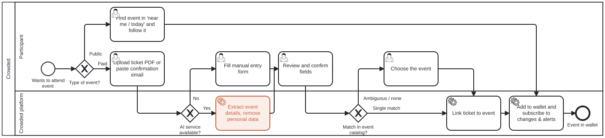
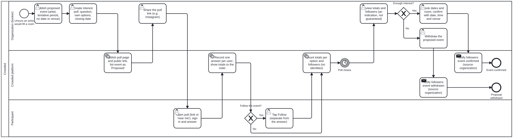
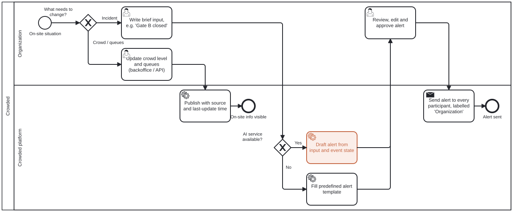

# Product Vision

## Vision Statement
Crowded keeps people informed when something changes or goes wrong at the events
they are attending, and gives organizations the tools to communicate with and
manage their audience before and during an event — bringing official changes,
on-site conditions, and organizer alerts into one place, so that participants and
organizations can make decisions based on current and reliable information.

## Personas

### Persona 1 — Inês, the Participant
- **Age/context:** 24 years old, university student in Lisbon
- **Goal:** keep track of the events she is going to — concerts bought on Ticketline,
  free public events like Santos Populares — without having to monitor ticketing
  sites, Instagram pages, and emails for updates
- **Frustration:** she has already arrived at a cancelled event without knowing,
  and has faced overcrowded venues and long queues she could have avoided
- **How Crowded helps:** she imports her tickets or follows public events, receives
  notifications when an event changes, and checks crowd levels, queues, and
  organizer alerts before leaving home — including estimates reported and
  confirmed by other participants when the organizer has published none

### Persona 2 — Miguel, the Organizer
- **Age/context:** 35 years old, event manager at a local cultural association
- **Goal:** plan capacity based on how many people actually intend to attend, and
  communicate quickly with everyone who is on their way or already at the venue
- **Frustration:** uses multiple channels (email, social media) to communicate
  updates, never knows whether everyone has been informed in time, and has no
  direct way to redirect the audience when something goes wrong on site
- **How Crowded helps:** attendance-intention polls for capacity planning, a
  backoffice (or API) to publish crowd levels, queues, and incidents, and direct
  alerts to every participant connected to the event

## Value Proposition
Unlike ticketing platforms and event-discovery apps, which stop being useful once
the ticket is bought, Crowded follows the event until it ends. It combines three
sources of information in one product — official changes synchronized from the
ticketing source, on-site conditions and alerts published by the organization, and
reports from participants, confirmed by other participants with a single tap — and
always shows where each piece of
information comes from and when it was last updated, reducing the uncertainty that
surrounds event disruptions today.

## Principal User Journeys

1. **Connect to an event**
   The user imports a ticket bought elsewhere (AI extracts the event details from
   the PDF or confirmation email, with manual confirmation as a fallback) or
   follows a public event. The user can also browse
   events nearby, but discovery is an entry point, not the core of the product.

2. **Get notified of changes**
   When the event is cancelled, postponed, or moved in the official source, the
   user receives a notification labelled with its origin — ideally before leaving
   home.

3. **Check conditions and decide**
   On the day of the event, the user checks crowd levels, queues, organizer
   alerts, and weather, each with its source and last-update time. The user reports
   what they see by choosing a predefined category (crowd level, queue length,
   lost and found, accessibility barrier, on-site problem) and the report is routed
   to the organization. For categories the organization has enabled, other
   participants connected to the event are asked to confirm it with a single
   "Yes" or "No"; their answers raise or lower the report's confidence (Low,
   Medium, High). Reports with Medium or High confidence appear on the event page
   as participant estimates, always marked as estimates that may not reflect
   reality — for crowd level and queues, only when the organization has no current
   value. Personal reports such as lost and found are never shown publicly or sent
   for confirmation. To report (other than personal categories) or to answer a
   confirmation, the user must allow location and be near the venue; Crowded
   explains that location is only used to ensure better report quality, checks it
   once at that moment and does not store it. When the organization marks a report as helpful, the user
   receives a recognition showing its impact.

4. **Plan and manage an event** (organizer)
   Before the event, the organizer launches an attendance-intention poll and
   adjusts staff and entrances based on the responses (an indication, not
   guaranteed attendance). Before or during the event, the organizer can also
   publish surveys (confirmations, polls, or calls for ideas) on the event page, marking
   them as urgent to notify participants. During the event, the organizer updates crowd levels
   and queues through the backoffice or API, resolves incidents, and sends alerts
   (e.g., "Gate B closed, use Gate C") from an AI-generated draft that they review
   before sending. Similar incident reports are grouped by AI so that the
   organizer handles one incident instead of many duplicates.

## Principal User Workflows

The diagrams below show the main workflows behind the user journeys, modelled in
BPMN 2.0 notation (pools and lanes per actor, events, tasks, exclusive gateways
and message flows). AI tasks are highlighted; each has a non-AI fallback path.
The editable sources are in [`bpmn/`](bpmn/) and open in
[bpmn.io](https://demo.bpmn.io) or Camunda Modeler.

### Workflow 1 — Connect to an event

### Workflow 2 — Official event change notification

### Workflow 3 — Organization manages an event

**Before the event**

**During the event**

### Workflow 4 — Report, confirmation and recognition

## Expected Community Benefit
Crowded reduces the impact of common event disruptions — cancellations, schedule
or venue changes, overcrowding, long queues, and on-site incidents — by
centralizing reliable communication and giving visibility into on-the-ground
conditions. This benefits participants (fewer wasted trips, safer and better-informed
decisions) and organizations (better capacity planning, faster incident response,
and a direct channel to their audience).

## MVP Boundary

**In the MVP:**
- Ticket wallet (ticket import) and following public events
- Minimal discovery ("near me / today")
- Synchronization with the official event source (ticketing simulator) and change
  notifications
- Organizer backoffice: crowd levels, queues, incidents, alerts, and
  attendance-intention polls
- Organizer API for crowd levels and queues (with an entrance-counter simulator)
- Participant reports with predefined categories (including crowd level and
  queues), "Yes"/"No" confirmations by other participants, and a rule-based
  confidence level shown with every participant estimate
- Per-event choice, by the organization, of which categories trigger confirmations
- Participant app on mobile and on the web (desktop and mobile browsers), with an
  in-app notification center, live banners and an unread badge on every client,
  and push notifications on the mobile app
- Reporting and confirming limited to users near the venue (one-time approximate
  location check, not stored)
- Provenance labels on all information
- Threshold-based weather alerts

**Out of scope for the MVP (for future versions):**
- Advanced search, filters, map, and recommendations
- Buying tickets within the app
- Social features and gamification
- Zone-level crowd information
- Real integrations with ticketing platforms and access-control systems
- Custom report categories defined by organizations
- Automatic warnings, temporary restrictions and bans from reporting for users whose
  reports are repeatedly unhelpful
- Automatic detection that a user has left the event (to be investigated first)

## Product Risks

- **Organizer adoption** — crowd levels, queues, and alerts depend on organizations
  using the backoffice or API; without them, only official changes, weather and
  participant estimates are available.
- **Stale information** — if organizations do not keep data updated, it loses
  value; last-update times must always be visible and outdated data hidden.
- **False alerts** — only the official source and verified organizations may
  publish official information.
- **Privacy** — tickets contain personal data and access codes; only the minimum
  data is stored, and participant reports and confirmations do not expose user
  identity.
- **Unreliable or abusive reports** — participant reports can be wrong, outdated or
  deliberately false; they are only shown once other participants confirm them,
  their confidence decays over time, they are always labelled as estimates, only
  users near the venue can report or confirm, and reports and confirmations are
  rate-limited. Automatic restriction of users with
  repeatedly unhelpful reports is planned after the MVP.
- **Location refusal** — users who do not allow location cannot report (except
  personal categories) or confirm, which may reduce the number of reports; the app
  explains why location is requested and uses it only once, without storing it.
- **Missed critical notifications** — users can turn off any notification type,
  including official changes and operational alerts; every type is on by
  default, turning these two off requires confirming a warning, and the
  information stays visible in the wallet and on the event page.
- **Browser users without push** — browsers get no push notifications in the MVP,
  so browser users only see notifications while the website is open; everything
  sent while they were away waits in the notification center, and the mobile app
  remains the recommended way to receive alerts in time.
- **Prompt fatigue** — asking every participant to confirm every report would be
  intrusive; only a small sample is asked, each user is asked at most once in a
  given period, and users can turn confirmation prompts off per event.
