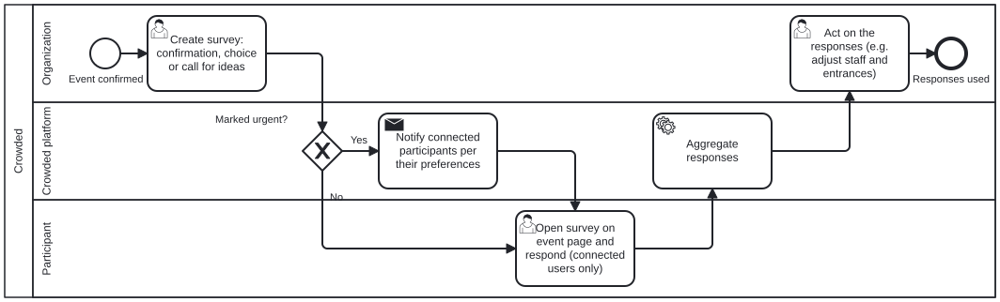
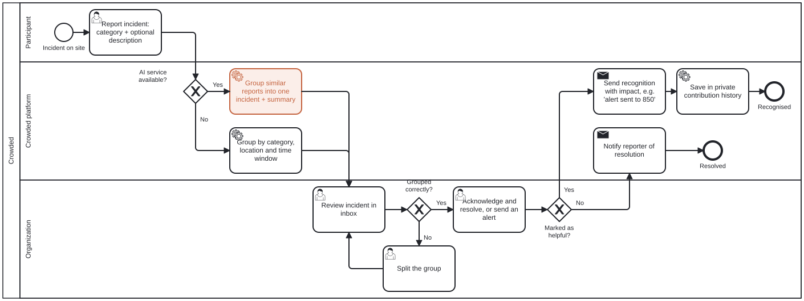

# Product Vision

## Vision Statement
Crowded keeps people informed when something changes or goes wrong at the events
they are attending, and gives organizations the tools to test interest in an event,
and to communicate with and manage their audience before and during it — bringing
official changes, on-site conditions, and organizer alerts into one place, so that
participants and organizations can make decisions based on current and reliable
information.

## Positioning
**Crowded does not sell tickets and is not where tickets are bought.** Ticketing
platforms (Ticketline, BOL, DICE, Eventbrite) handle the purchase; Crowded covers
what happens around it:

| Phase | Who serves it today | What Crowded does |
|---|---|---|
| **Before booking** — is there enough interest for this artist, one night or two, which room? | Organizer's intuition, social media polls | Proposed events and interest polls with organizer-defined options |
| **Purchase** | Ticketing platforms | Nothing — Crowded never sells, resells or links to tickets |
| **After the purchase, until the event ends** — what changed, what is happening at the venue now | Ticketing emails, social media, on-site staff | Official changes, organizer alerts, crowd levels, queues and participant reports, each with its source and time |

A ticket only enters Crowded when the participant imports one bought elsewhere;
free public events need no ticket at all.

## Personas

Inês is the primary persona: the north star metric measures how early she learns
about a disruption. Miguel and Rita are the two people at an organization who make
that possible — one before the event, one on the night.

**Why these three.** They cover the two sides of the stakeholder map
([Problem and Opportunity Report, section 4](problem-and-opportunity-report.md#4-stakeholder-map)):
the attendee, and the organization in its two moments, deciding before the event and
operating it on the night. Each frustration comes from a documented problem or a
user-research finding, cited under **Basis**. Organizers were not part of the user
research ([its limitations](user-research.md#limitations)), so Miguel and Rita rest on
the problem evidence and on assumptions A2 and A3. Interviews with organizers in
Sprint 3 validate them ([Assumptions](problem-and-opportunity-report.md#5-assumptions)).

### Persona 1 — Inês, the Participant
- **Age/context:** 24 years old, university student in Porto
- **Goal:** keep track of the events she is going to — concerts bought on Ticketline,
  free public events like São João — and of shows she would like to see, without
  having to monitor ticketing sites, Instagram pages, and emails for updates
- **Frustration:** she has already arrived at a cancelled event without knowing,
  and has faced overcrowded venues and long queues she could have avoided
- **How Crowded helps:** she votes in polls for shows she would go to and follows
  them, imports her tickets or follows public events, receives notifications when an
  event is confirmed or changes, and checks crowd levels, queues, and organizer
  alerts before leaving home — including estimates reported and confirmed by other
  participants when the organizer has published none
- **Basis:**
  - Changes spread across channels and arriving too late
    ([Problem Evidence 3.1](problem-and-opportunity-report.md#31-fragmented-communication-of-changes)).
  - Documented cases of audiences already at the venue when a show was cancelled, and of
    queues of over an hour ([3.6](problem-and-opportunity-report.md#36-documented-disruptions-in-portugal-and-europe)).
  - User research: alerts that never arrived, and tickets hard to reach while travelling
    ([Findings](user-research.md#summary-of-findings)).

### Persona 2 — Miguel, the Booker
- **Age/context:** 35 years old, programmer (booker) at a mid-size concert venue in
  Porto, such as Hard Club, with rooms of different sizes
- **Goal:** decide whether to bring an artist, for how many nights and in which room
  based on how many people are actually interested, and tell everyone who cares when
  a show is confirmed, postponed or cancelled
- **Frustration:** books on intuition and Instagram likes, which do not say how many
  people would really come; announces changes on several channels and never knows
  whether everyone was informed in time
- **How Crowded helps:** publishes a proposed event before booking, runs an interest
  poll with his own options, shares it through a public link, sees the totals and how
  many people follow the event, then confirms or withdraws it and publishes any later
  change — all followers and ticket holders are notified once
- **Basis:**
  - Organizers plan capacity on intuition
    ([3.4 Limited Capacity Planning](problem-and-opportunity-report.md#34-limited-capacity-planning)).
  - Ticketing platforms stop at the purchase
    ([3.2](problem-and-opportunity-report.md#32-ticketing-platforms-stop-at-the-purchase)).
  - Validated by assumption A3.

### Persona 3 — Rita, the Front-of-House Manager
- **Age/context:** 29 years old, front-of-house manager at the same venue
- **Goal:** keep the audience safe and moving on the night: entrances, queues,
  capacity, and incidents
- **Frustration:** when an entrance closes or a room is full, she can only redirect
  people through staff at the doors and a social media post that few people see in
  time
- **How Crowded helps:** publishes crowd levels and queues through the backoffice (or
  automatically through the API), sends alerts such as "Gate B closed, use Gate C" to
  everyone connected to the event from an AI-generated draft she reviews, and handles
  similar participant reports as a single incident
- **Basis:**
  - No direct organizer-to-audience channel during events
    ([3.5](problem-and-opportunity-report.md#35-no-direct-organizer-to-audience-channel-during-events)).
  - No real-time on-site awareness
    ([3.3](problem-and-opportunity-report.md#33-lack-of-real-time-on-site-awareness)).
  - Validated by assumption A2.

Miguel and Rita are both members of the same organization in Crowded; they use the
same backoffice with the same permissions.

## Value Proposition
Unlike ticketing platforms and event-discovery apps, which stop being useful once
the ticket is bought, Crowded follows the event from the moment it is proposed until
it ends. It combines three sources of information in one product — official changes
published by the organization or synchronized from the ticketing source, on-site
conditions and alerts published by the organization, and reports from participants,
confirmed by other participants with a single tap — and always shows where each
piece of information comes from and when it was last updated, reducing the
uncertainty that surrounds event disruptions today.

## The Story of One Show

The principal user journeys below all appear in the life of a single show:

1. **Propose.** Miguel is unsure whether Artist X would fill a room. He publishes a
   proposed event — "Artist X @ Hard Club, spring 2027, date and room to be
   confirmed" — with an interest poll whose options he writes himself ("Sala 1",
   "Sala 2", "Two nights").
2. **Reach.** Miguel shares the poll link on Instagram. The proposed event also
   appears in the "near me" list, labelled *Proposed — not confirmed*.
3. **Vote.** Inês opens the link, signs in and votes, and then sees the totals. Voting
   does not follow the event: she taps **Follow** on the poll page because she wants
   to hear when it is confirmed. Miguel sees the totals and the number of followers,
   never who voted.
4. **Decide.** The interest is strong, so Miguel books two nights in the bigger room
   and sets the dates and venue. The event is confirmed and every follower is
   notified.
5. **Buy elsewhere.** Inês buys her ticket on Ticketline — outside Crowded — and
   imports it. Miguel has linked his event to the Ticketline event, so her ticket
   matches it.
6. **Postpone.** The artist falls ill. Miguel publishes the postponement in Crowded;
   when the ticketing source reports the same change minutes later, Crowded merges
   them, so Inês receives **one** notification saying what changes for her: the new
   date, whether her ticket is still valid, and where to ask for a refund.
7. **Show day.** Gate B breaks down. Rita sends "Gate B closed, use Gate C" from an
   AI draft she reviewed, to everyone connected to the event — ticket holders and
   followers.
8. **On site.** Inês reports a long queue at Gate C. Other participants nearby
   confirm it, Rita sees one grouped incident and resolves it, and Inês receives a
   private recognition showing the impact of her report.

## Principal User Journeys

1. **Test interest in an event** (Miguel)
   Before booking, the organizer publishes a proposed event with a tentative period
   instead of a date and venue, and an interest poll with their own question, answer
   options and closing date. The poll has a public link that anyone can open and
   share; answering requires an account. Each participant answers once and can change
   their answer until the poll closes, and sees the totals after answering. Answering
   never follows the event — the poll page has a separate Follow button. The organizer
   sees the totals per option and the number of followers, presented as an indication
   of interest, not guaranteed attendance, and never who answered. When the decision
   is made, the organizer confirms the event by setting its date, time and venue, or
   withdraws it; followers are notified either way.

2. **Connect to an event** (Inês)
   The user imports a ticket bought elsewhere (AI extracts the event details from
   the PDF or confirmation email, with manual confirmation as a fallback) or
   follows an event — a public event, or a proposed event from its poll. The user can
   also browse events nearby, but discovery is an entry point, not the core of the
   product.

3. **Get notified of changes** (Inês, Miguel)
   When the event is confirmed, cancelled, postponed, or moved, the user receives a
   notification labelled with its origin — the organization or the ticketing source —
   ideally before leaving home. When both report the same change, it is recorded and
   notified once, listing both sources. The notification says what changes for them:
   the new date, time or venue, whether their ticket is still valid and, when there is
   one, where to ask for a refund.

4. **Check conditions and decide** (Inês)
   On the day of the event, the user checks crowd levels, queues, organizer
   alerts, and weather, each with its source and last-update time. The user reports
   what they see by choosing a predefined category (crowd level, queue length,
   lost and found, accessibility barrier, on-site problem) and the report is routed
   to the organization. For categories the organization has enabled, other
   participants connected to the event are asked to confirm it with a single
   "Yes" or "No"; their answers raise or lower the report's confidence (Low,
   Medium, High). Reports with Medium or High confidence appear on the event page
   as participant estimates, always marked as estimates that may not reflect
   reality — for crowd level and queues, only when the organization has no current
   value. Personal reports such as lost and found are never shown publicly or sent
   for confirmation. To report (other than personal categories) or to answer a
   confirmation, the user must allow location and be near the venue; Crowded
   explains that location is only used to ensure better report quality, checks it
   once at that moment and does not store it. When the organization marks a report as helpful, the user
   receives a recognition showing its impact.

5. **Manage the event** (Rita, Miguel)
   Before or during a confirmed event, the organizer can publish surveys
   (confirmations, multiple-choice questions, or calls for ideas) on the event page
   for the participants connected to it, marking them as urgent to notify them.
   Unlike interest polls, surveys are not public. During the event, the organizer
   updates crowd levels and queues through the backoffice or API, resolves incidents,
   and sends alerts (e.g., "Gate B closed, use Gate C") to everyone connected to the
   event from an AI-generated draft that they review before sending. Similar incident
   reports are grouped by AI so that the organizer handles one incident instead of
   many duplicates.

## Principal User Workflows

The diagrams below show the main workflows behind the user journeys, modelled in
BPMN 2.0 notation (pools and lanes per actor, events, tasks, exclusive gateways
and message flows). AI tasks are highlighted; each has a non-AI fallback path.
The editable sources are in [`bpmn/`](bpmn/) and open in
[bpmn.io](https://demo.bpmn.io) or Camunda Modeler.

### Workflow 1 — Connect to an event

### Workflow 2 — Official event change notification

### Workflow 3 — Organization manages an event

**Before the event: propose it and test interest**

**During the event**

**Surveys for connected participants**

### Workflow 4 — Report, confirmation and recognition

## Expected Community Benefit
Crowded reduces the impact of common event disruptions — cancellations, schedule
or venue changes, overcrowding, long queues, and on-site incidents — by
centralizing reliable communication and giving visibility into on-the-ground
conditions. This benefits participants (fewer wasted trips, safer and better-informed
decisions) and organizations (better booking and capacity decisions, faster incident
response, and a direct channel to their audience).

Crowded supports the three phases of a disruption (see the Problem and Opportunity
Report, section 2.1): **anticipating** it before leaving home (official changes,
doors opening time, weather), **responding** on the way and on site (alerts, crowd
levels, queues, reports and incidents) and **recovering** afterwards (what changes
for the participant, resolved alerts and incidents, and a post-event summary for
the organization). Interest polls act even earlier: an event sized to its real
demand is less likely to be overcrowded, moved to another room or cancelled.

Crowded combines **trustworthy information** with **coordinated action**: every item
shows its source and, for participant estimates, how many people confirmed it, and each one leads to an action. Organizers redirect
people with alerts that say what to do ("Gate B closed, use Gate C"), participants
confirm or correct what others report, and interest polls let organizers choose the
number of nights, the room, staff and entrances before the event. Participation is
encouraged through private recognition and a contribution history (see the
[Ethical Engagement Design](ethical-engagement-design.md)).

## Success Criteria

Crowded is measured by how early the people affected by a disruption know about it.

**North star metric:** the share of participants connected to a disrupted event who
are notified **before the doors open** (or before the start time, when no doors
opening time is known), for disruptions published before that time.
**MVP target: at least 90%.**

| Criterion | MVP target | How it is measured |
|---|---|---|
| Participants notified before the doors open (north star) | ≥ 90% | Delivery time of each notification compared with the event's doors opening time, using the disruption that caused it (`Notification.causeId`, `Event.doorsOpenAt`) |
| Critical disruptions delivered in time | 95% within 1 minute of detection or publication (NFR-001); source changes detected within 5 minutes (NFR-002) | Service-level indicators in the operational dashboard |
| Each change notified once | 100% of changes reported by both the organization and the ticketing source produce one notification per user (FR-078, NFR-003) | Notifications per user per `EventChange` |
| Alerts closed when the situation ends | ≥ 90% of operational alerts resolved before the event ends (FR-073) | `Alert.resolvedAt` compared with the event's end time |
| Incident response | Median time from the first report to the incident being acknowledged ≤ 10 minutes | Report and incident timestamps |
| Plans changed thanks to a notice | Tracked, no target in the MVP | Optional in-app question after a critical notice: "Did this change your plans?" |
| Interest polls that lead to a decision | Tracked, no target in the MVP | Share of proposed events that are confirmed or withdrawn after their poll closes |

The targets are initial values. They are checked with the ticketing and
entrance-counter simulators in Sprint 3 and revised with real organizers after the MVP.

## MVP Boundary

**In the MVP:**
- Ticket wallet (ticket import) and following public and proposed events
- Minimal discovery ("near me / today"), including proposed events with open polls
- Proposed events that the organization later confirms (date, time and venue) or
  withdraws, notifying followers
- Interest polls with organization-defined options, a public shareable link,
  results shown to each participant after answering, and a separate Follow button
- Synchronization with the official event source (ticketing simulator) and change
  notifications that say what changes for the participant (new date, time or venue,
  ticket validity and refund information)
- Changes published by the organization, merged with the same change from the
  ticketing source so it is notified once, for events the organization has linked to
  the ticketing source
- Severity of every change and alert (critical, warning, information), alerts that
  the organization marks as resolved, and the doors opening time
- Post-event summary for the organization (crowd peaks, incidents, alerts sent)
- Offline access to the essential information of the user's events (ticket, entry code,
  latest change, active alerts), and delivery through the notification center and live
  banners when push notifications fail
- Private recognition and contribution history for participants who report and confirm
- Organizer backoffice: crowd levels, queues, incidents, alerts, interest polls and
  surveys
- Organizer API for crowd levels and queues (with an entrance-counter simulator)
- Participant reports with predefined categories (including crowd level and
  queues), "Yes"/"No" confirmations by other participants, and a rule-based
  confidence level that decides which estimates are shown (each estimate shows how
  many participants confirmed it; the level itself is shown only to the organization)
- Per-event choice, by the organization, of which categories trigger confirmation prompts
- Participant app on mobile and on the web (desktop and mobile browsers), with an
  in-app notification center, live banners and an unread badge on every client,
  and push notifications on the mobile app
- Reporting and confirming limited to users near the venue (one-time approximate
  location check, not stored)
- Provenance labels on all information
- Threshold-based weather alerts

**Out of scope for the MVP (for future versions):**
- Advanced search, filters, map, and recommendations
- Following an organization (polls reach people through their public link and
  discovery)
- Social features and gamification
- Zone-level crowd information
- Real integrations with ticketing platforms and access-control systems
- Custom report categories defined by organizations
- Automatic warnings, temporary restrictions and bans from reporting for users whose
  reports are repeatedly unhelpful
- Automatic detection that a user has left the event (to be investigated first)

**Never in scope:** selling, reselling or linking to tickets, and announcing when
tickets go on sale. This is the job of ticketing platforms.

## Product Risks

- **Organizer adoption** — crowd levels, queues, alerts and interest polls depend on
  organizations using the backoffice or API; without them, only official changes from
  the ticketing source, weather and participant estimates are available.
- **Stale information** — if organizations do not keep data updated, it loses
  value; last-update times must always be visible and outdated data hidden.
- **False alerts** — only the official source and verified organizations may
  publish official information, including proposed events and their changes.
- **Duplicate or conflicting changes** — the organization and the ticketing source can
  report the same change at different times or with different details; changes are
  merged only for events the organization has linked to the ticketing source, both
  sources are shown, and each user is notified once.
- **Proposed events mistaken for confirmed ones** — a proposed event has no date or
  venue; it is always labelled *Proposed — not confirmed*, and cannot have tickets
  imported into it until it is confirmed.
- **Misleading poll results** — votes are an indication, not a commitment, and
  participants see the totals after voting, which can push later votes towards the
  leading option; results are always presented as an indication of interest, and the
  follower count is shown next to them as a stronger signal.
- **Privacy** — tickets contain personal data and access codes; only the minimum
  data is stored, and participant reports, confirmations and poll answers do not
  expose user identity.
- **Unreliable or abusive reports** — participant reports can be wrong, outdated or
  deliberately false; they are only shown once other participants confirm them,
  their confidence decays over time, they are always labelled as estimates, only
  users near the venue can report or confirm, and reports and confirmations are
  rate-limited. Automatic restriction of users with
  repeatedly unhelpful reports is planned after the MVP.
- **Location refusal** — users who do not allow location cannot report (except
  personal categories) or confirm, which may reduce the number of reports; the app
  explains why location is requested and uses it only once, without storing it.
- **Missed critical notifications** — users can turn off any notification type,
  including official changes and operational alerts; every type is on by
  default, turning these two off requires confirming a warning, and the
  information stays visible in the wallet and on the event page.
- **Browser users without push** — browsers get no push notifications in the MVP,
  so browser users only see notifications while the website is open; everything
  sent while they were away waits in the notification center, and the mobile app
  remains the recommended way to receive alerts in time.
- **Prompt fatigue** — asking every participant to confirm every report would be
  intrusive; only a small sample is asked, each user is asked at most once in a
  given period, and users can turn confirmation prompts off per event.
