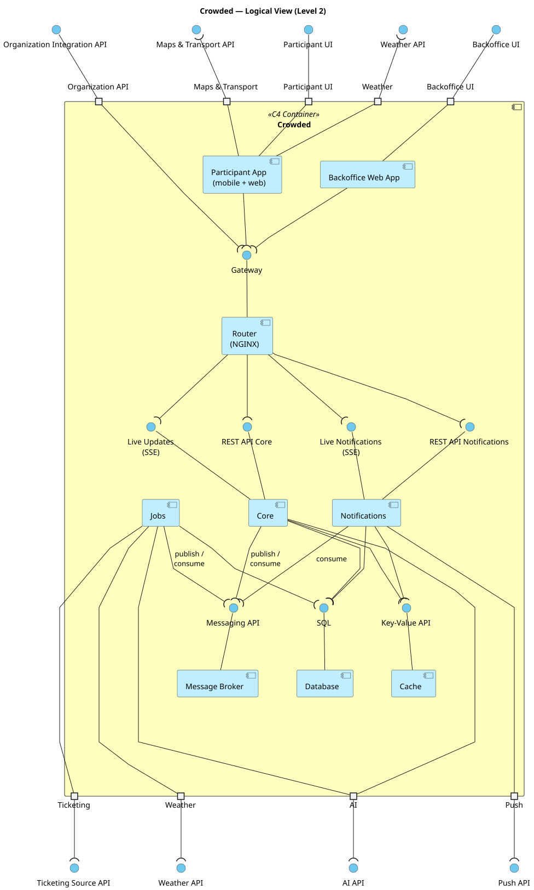
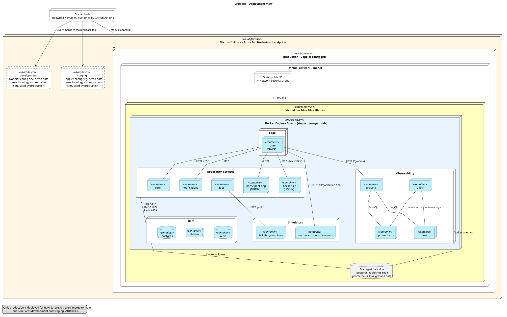

# Technical Design

This document describes how Crowded is structured and deployed. The domain model is in the [README](/README.md#domain-model), and the reasoning behind each choice is in the [Architecture Decision Records](adr/).

The diagram sources are in [`diagrams/`](diagrams/) (PlantUML).

## Logical View (Level 2)

The system is split into two client apps, a router, three backend services and three pieces of infrastructure. External systems sit outside the boundary and are reached through ports.

| Component | Responsibility | Owns (writes) |
|---|---|---|
| **Participant App** | Participant app for mobile and the web (Flutter). Calls the maps and transport providers directly for display. | – |
| **Backoffice Web App** | Organizer app, and the administrator's page to create organizations and their members. | – |
| **Router (NGINX)** | Single entry point for both apps: TLS and routing. | – |
| **Core** | Domain rules, authentication (issues JWTs), access to event pages, REST API, live event-page updates (SSE), AI ticket extraction and alert drafts. Applies the weather data fetched by Jobs. | Users, organizations, events, connections, on-site information, weather, alerts, surveys, reports, incidents |
| **Jobs** | All background work: IPMA weather warnings and forecasts, AI report grouping, and periodic tasks (confidence decay, outdated information). | Weather snapshots |
| **Notifications** | Fan-out to connected users, preferences, deduplication, notification center and live banners (SSE); push to the mobile app later. | Notifications, device tokens |
| **Message Broker** | Asynchronous messages between Core, Jobs and Notifications, with retries and a dead-letter queue. | – |
| **Database** | One PostgreSQL database. Each table has one owning (writing) service; other services may only read it. | – |
| **Cache** | Token revocation list, rate-limit counters and read cache. | – |

Synchronous traffic goes through the Router to Core and Notifications. Everything else between services goes through the Message Broker: for example, Core records a change published by the organization and publishes `NotificationRequested`, and Notifications delivers it; Jobs publishes the IPMA data it fetched, and Core applies it ([Asynchronous Flows](asynchronous-flows.md)).

## Data Model

Based on the [Domain Model](../../README.md#domain-model), the diagram specifies attributes, keys and constraints using PostgreSQL data types and conventions. PostgreSQL was selected as the database in [ADR 0002](adr/0002-shared-database-with-table-ownership.md).

- **Keys and uniqueness:** `PK` identifies the primary key, `FK` a foreign key, and `UK` a unique constraint. Multiple `UK` attributes in one entity form a composite unique constraint.
- **Entity structure:** an event's location and crowd status are represented by columns on `Event`, while information that can have multiple entries, such as queue times, weather forecasts and warnings, is modeled as separate entities.
- **Nullable columns:** `[NULL]` marks a column that may have no value.
- **Data labels:** `[PERSONAL]`, `[PRIVACY-SENSITIVE]` and `[CREDENTIAL]` label personal, sensitive or credential data. `[MAY CONTAIN PERSONAL DATA]` marks free-text fields that may include personal data. `[ENCRYPTED]` marks data specified to be stored encrypted.
- **Ownership:** entities are grouped by their owning component. As specified in [ADR 0002](adr/0002-shared-database-with-table-ownership.md), each table has one owning service that may write to it, while other services may read it.
- **Implementation:** the tables are created by the Flyway migrations in [`database/`](../../database/README.md), with the model's names in snake_case (`User` is `app_user`). Each service connects as its own database user, which can write only the tables it owns, and only the migrations change the schema ([ADR 0012](adr/0012-database-migrations-with-flyway.md)).
- **Enumerated values:** enum types represent fields that can take one of a defined set of values.
- **Ticketed and public events:** every event belongs to the organization that registered it. A `TICKETED` event stores the event code printed on its tickets (`ticketEventCode`), and a `PUBLIC` event the access code that the organization gives out (`accessCode`). Both are unique among upcoming events (FR-086). A `Connection` links a participant to an event, of type `TICKET` or `ACCESS_CODE`, and is the only thing that gives access to the event's page (SR-020).
- **Tickets:** a `Ticket` keeps its entry code encrypted and a keyed hash of it, unique per event, so the same QR code cannot be imported by two accounts (FR-084, SR-018). An import waiting for its typed event code is kept in Redis, not in the database, and expires after 30 minutes (FR-004, FR-083).
- **Surveys:** an `EventSurvey` is only shown to participants connected to the event (FR-051). It keeps the responder's `userId` only to enforce one answer per participant and let them change it; organizations only ever see totals.
- **Organization accounts:** an organization member's account is created by a platform administrator with a temporary password (`User.mustChangePassword`, `User.temporaryPasswordExpiresAt`); a deactivated member (`User.active = false`) cannot sign in (FR-087, FR-088, SR-022).
- **Disruptions:** `EventChange` and `Alert` carry a `severity` (`CRITICAL`, `WARNING`, `INFO`) that decides how prominently they are shown (FR-074). It is stored rather than derived from the type, because the same type can have different severities: a start-time change is critical, while a doors-opening change (`Event.doorsOpenAt`, FR-072) is a warning. A sent alert is active until `resolvedAt` is set, when the organization resolves it (FR-073); its status stays `SENT`.
- **Recovery after a change:** `EventChange.ticketStillValid` and `EventChange.refundInfo` tell participants what a cancellation, postponement or relocation means for them (FR-075). Both are nullable, because the organization does not always provide them, and the app then says that the information is not available instead of guessing.
- **Notification cause:** `Notification.causeId` points to the `EventChange`, `Alert`, `WeatherWarning` or `Incident` that triggered it, and the notification type says which. It has no foreign key because those tables belong to Core and the id arrives in the message ([ADR 0002](adr/0002-shared-database-with-table-ownership.md), [ADR 0003](adr/0003-rabbitmq-for-asynchronous-messaging.md)). It makes each notification traceable to its disruption and lets us measure delivery time against NFR-001.

## External Integrations

Crowded reaches every external system through an adapter ([ADR 0010](adr/0010-external-integrations.md)). Each adapter has a fake implementation for tests, so no test depends on a real provider (TR-008). Weather comes from IPMA ([ADR 0015](adr/0015-organization-as-the-only-event-source.md)), and ticket extraction from a model on Groq ([ADR 0020](adr/0020-groq-for-ticket-extraction.md)). The vendors for the other AI tasks, maps and the transport feed are still open, so their sections state what Crowded sends, what it expects back and the limits it applies, independently of the vendor. There is no ticketing integration: the organization is the only source of event information.

| Integration | Used by | Direction and protocol | In the MVP | When it fails |
|---|---|---|---|---|
| Ticket extraction (Groq) | Core | Core calls Groq's OpenAI-compatible API, HTTPS and JSON | Yes | Typed event code |
| AI provider (alert drafts, report grouping) | Core, Jobs | Crowded calls the provider, HTTPS and JSON | Yes | Manual alerts, rule-based grouping of reports |
| IPMA (weather) | Jobs | Crowded polls IPMA's open data, HTTPS and JSON | Yes | Last known forecast and warnings with their time, no notification from invalid data |
| Maps provider | Participant App | The app calls the provider, HTTPS | Yes (FR-056) | Venue address and a message that live data is unavailable |
| Transport feed (GTFS) | Participant App | The app reads the operator's feed, HTTPS | Yes (FR-055) | A message that live transport data is unavailable |
| Push (Firebase Cloud Messaging) | Notifications | Crowded calls FCM, HTTPS | Yes, after in-app notifications | Notification center and live banners, push retried with backoff |

Rules shared by all integrations:

- **Timeouts and retries.** Every call has a timeout. Background calls (Jobs, Notifications) are retried with exponential backoff up to a limit, and messages that keep failing go to the dead-letter queue (NFR-004). Interactive calls (ticket extraction, alert drafts) are not retried in a loop. On failure, the user gets the manual path at once.
- **Validation.** Every response is validated against a schema before it is used. Invalid records are rejected and logged, and never overwrite the last valid data (NFR-005).
- **Provenance.** Data that comes from an integration keeps its source and last-update time (FR-032): `EXTERNAL_SERVICE` with the provider's name (IPMA, the transport operator) and `AI_GENERATED` for AI output. Information published by the organization is `ORGANIZATION`.
- **Secrets.** Provider keys and service accounts are kept in Doppler and mounted as Docker Swarm secrets, never in the repository (SR-008).
- **Observability.** Every call is logged with its trace identifier, duration and result. The operational dashboard shows weather-warning detection lag, push failures, and AI latency and error rate (NFR-010, NFR-012).

Intervals, timeouts and rate limits below are initial values. They are checked with the adapters' fakes and the demo script in Sprint 3 and adjusted when the vendors are chosen.

### AI Provider

- **Purpose.** Three assisted tasks: extracting the event code and ticket details from an imported ticket and drafting alerts for organizers (Core), and grouping similar incident reports (Jobs). The [Responsible AI Opportunity Assessment](responsible-ai-opportunity-assessment.md) describes them and how they are evaluated.
- **Model.** Ticket extraction uses `qwen/qwen3.8-27b` on Groq's free plan, over HTTPS with the key in `GROQ_API_KEY` ([ADR 0020](adr/0020-groq-for-ticket-extraction.md)). The vendor for alert drafts and report grouping is still open (ADR 0010).
- **Protocol.** JSON and structured output: the response must match a fixed schema for each task.
- **Data sent.**
  - *Ticket extraction:* text extracted locally from the ticket PDF, or read locally by OCR from the screenshot, with personal data (name, email, tax number) and entry codes removed (SR-004, SR-018). Entry codes are decoded locally, without AI (FR-070).
  - *Alert drafts:* the event's current state (crowd level, queues, open incidents) and the organizer's short input.
  - *Report grouping:* category, time and description of each report, without the reporter's identity (SR-007).
- **Data received.** Only the fields of the schema: the event code and the gate, sector and seat for a ticket, a draft text for an alert, and groups of report ids with a short summary for incidents.
- **Limits.** Ticket extraction has a 25 second timeout, so it completes within 30 seconds (NFR-009); Groq answered in under a second in the evaluation. Alert drafts have a 10 second timeout. AI requests are rate limited per user and per organization to control cost and stay within the provider's free plan.
- **Safety.** Ticket files and organization input are treated as untrusted. Output that does not match the schema is discarded, and the AI never performs actions (SR-005). The extracted event code only links a ticket on an exact match with a registered event, and the participant then sees the registered event's data, not the extraction. Gate, sector and seat never decide anything and are shown only on the participant's own ticket. Drafts and summaries are labelled as AI-generated until approved (NFR-007).
- **Failures.** If the model or the provider is unavailable, too slow or returns invalid output, the participant is asked for the event code, or the organizer gets the manual alert editor, at once, and reports are grouped by category and time window (NFR-006, FR-053). Grouping jobs are retried later through the broker.

### IPMA (Weather)

- **Purpose.** Weather warnings for the district of each event and its forecast (FR-035, FR-036). Warnings are rule-based, not AI. IPMA's open data is real, public and needs no key, which makes it the external integration of the MVP ([ADR 0015](adr/0015-organization-as-the-only-event-source.md)).
- **Protocol.** HTTPS with JSON. Jobs polls `warnings_www.json` for the warnings of every warning area, and `cities/daily/{globalIdLocal}.json` for the five-day forecast of a district capital. `distrits-islands.json` maps each district to its warning area (`idAreaAviso`) and `globalIdLocal`.
- **Data sent.** Nothing but the request. The participant's location is never sent.
- **Data received.** For each warning: area, type (e.g., wind, rain, heat), level (green, yellow, orange, red), start and end time. For each forecast day: minimum and maximum temperature, precipitation probability, wind and weather type.
- **Processing.** Jobs keeps only the districts of upcoming or ongoing events, compares them with the last snapshot and publishes `WeatherUpdated` when something changed. Core stores `WeatherForecast` and `WeatherWarning` per event, labelled with IPMA as source, and notifies orange and red warnings that overlap the event (FR-036, [Asynchronous Flows](asynchronous-flows.md#4-weather-warning-flow)).
- **Limits.** Warnings every 5 minutes, so they are detected within 10 minutes (NFR-021); forecasts every hour for events up to 5 days ahead. Each call has a 10 second timeout. A warning is notified once per event, area, type and level.
- **Failures.** The last known forecast and warnings are shown with their time, or a message that they are unavailable. Invalid data is rejected and never triggers a notification (NFR-005).

### Maps and Transport

- **Purpose.** Map of the venue, routes to it, and public transport departures with service disruptions from a real GTFS feed (FR-055, FR-056). The transport operator is chosen in its story, for example Carris Metropolitana, whose feed and API are open.
- **Protocol.** The participant app calls the provider directly over HTTPS. Requests do not go through the Crowded backend.
- **Data sent.** The venue location and, only with the user's consent, their approximate location or a location they chose (SR-009). Crowded does not store it.
- **Data received.** Map tiles, routes, nearby stops with upcoming departures and service disruptions.
- **Limits.** Short timeouts, and map tiles cached on the device within the provider's terms of use.
- **Failures.** The app shows the venue address and a message that live directions and transport data are unavailable.

### Push Notifications (Firebase Cloud Messaging)

- **Purpose.** Reach the mobile app when it is closed or in the background (FR-069). FCM also delivers to iOS through Apple's push service. Browsers get no push in the MVP.
- **Protocol.** Notifications calls the FCM HTTP v1 API over HTTPS, authenticated with a Google service account kept as a secret (SR-008). The mobile app registers its device token with Notifications after sign-in and removes it on sign-out.
- **Data sent.** The device token, a short title and text, and the id of the notification so the app can open the related item. Entry codes and other personal data are never included.
- **Data received.** The delivery result. A token reported as invalid or unregistered is removed.
- **Limits.** Critical notifications must reach the device within 1 minute (NFR-001). Each notification is pushed once per device, and the app discards a push for a notification it has already shown, so retries never notify twice (NFR-003).
- **Failures.** The notification is already stored in the notification center and shown as a live banner on open clients. Push is retried with backoff, and failures are logged and shown on the operational dashboard (NFR-020). This is the degraded mode demonstrated in the final presentation (see [Degraded Operation](#degraded-operation)).

### Not Covered Yet

- Sign-in with Google or Facebook is outside the MVP and will be added to this section when it is planned.
- Integrations with ticketing platforms, which would let Crowded check that a ticket is genuine, and with organizations' own systems such as entrance counters, are after the MVP ([Product Vision](product-vision.md#mvp-boundary)).

## Deployment View

- The design has three deployed environments, **development**, **staging** and **production**, each a copy of this view with its own Doppler config. Every merge to `main` goes to development, a release tag promotes the same images to staging, and a manual approval promotes them to production. In practice only production is deployed and it simulates the other two ([ADR 0013](adr/0013-single-azure-vm-docker-swarm-with-terraform.md#environments)). Local development and CI are not environments.
- Everything runs on **one Azure virtual machine** (Ubuntu) inside a virtual network, provisioned with **OpenTofu** on the Azure for Students subscription ([ADR 0013](adr/0013-single-azure-vm-docker-swarm-with-terraform.md)). The region and VM size are variables (`spaincentral` and a `Standard_B2ls_v2`, 2 vCPU and 4 GB, [ADR 0014](adr/0014-opentofu-state-access-and-deployment-from-main.md)), so it can grow without redesign.
- The instance runs a **single-node Docker Swarm**. Each box in the diagram is a container (Swarm service) with a health check; Swarm restarts failed containers.
- Only the **router (NGINX)** publishes ports (443). All other containers are reachable only on internal overlay networks.
- The **participant-app** and **backoffice** containers each serve their app's static bundle with NGINX; the router sends `/backoffice/` to the backoffice and every other page to the participant app ([ADR 0011](adr/0011-ci-pipeline-and-vulnerability-policy.md)).
- No simulator is deployed. The demonstration uses the seed data and a demo script that runs outside the stack and calls the public API with demo accounts (TR-009).
- **Observability:** Prometheus scrapes the services and RabbitMQ; Alloy collects container logs (to Loki) and Postgres, Redis and host metrics (to Prometheus); Grafana shows both, behind the router at `/grafana`.
- Stateful containers keep their data in Docker volumes on a **managed data disk**.
- Images are built by GitHub Actions and pushed to Docker Hub ([ADR 0011](adr/0011-ci-pipeline-and-vulnerability-policy.md)); secrets come from Doppler and are mounted as Docker Swarm secrets. The stack, deploy and rollback scripts are in [`deployment/`](/deployment/README.md).

## Degraded Operation

A disruption can also affect Crowded itself. Each scenario below keeps the principal workflows running and tells users what is limited:

| Unavailable | What keeps working | What users see | Requirement |
|---|---|---|---|
| Push notification provider | Notifications are stored in the notification center and shown as live banners on open clients; Notifications retries the push with backoff and never sends twice | Every notification in the app, even without a push | NFR-020 |
| Network at the venue | Ticket, entry code, doors opening time, latest change and active alerts are cached on the device | The cached information, with the time of the last synchronization | FR-037 |
| IPMA | Jobs keeps the last valid data and rejects invalid data | The last forecast and warnings with their time | NFR-005 |
| AI service | Typed event code for tickets, manually written alerts, rule-based grouping of reports | The event-code field or the manual editor instead of the AI result | NFR-006, FR-053 |

The final presentation demonstrates the **push provider failure**: with the provider switched off in production, a change published by the organization still reaches participants through the notification center and the live banner, and the failed push attempts appear in the logs and in the operational dashboard.
