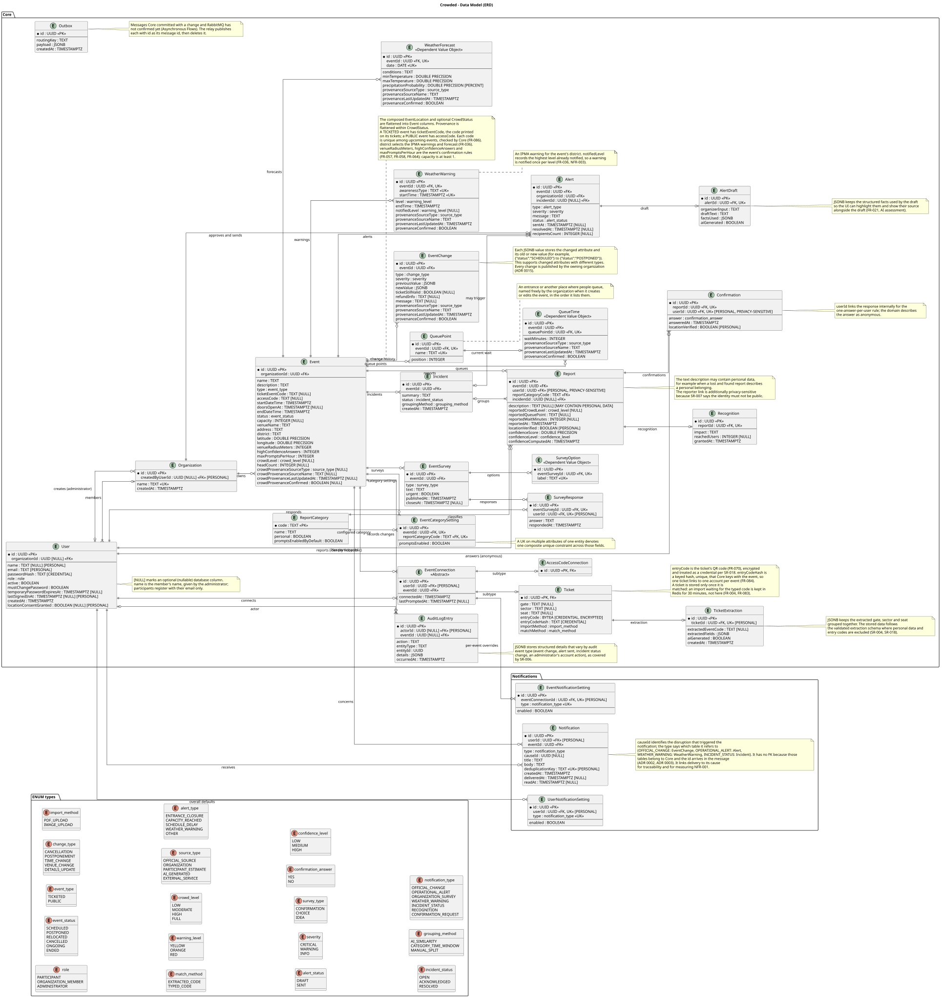

# Technical Design

This document describes how Crowded is structured and deployed. The domain model is in the [README](/README.md#domain-model), and the reasoning behind each choice is in the [Architecture Decision Records](adr/).

The diagram sources are in [`diagrams/`](diagrams/) (PlantUML).

## Logical View (Level 2)

The system is split into two client apps, a router, three backend services and three pieces of infrastructure. External systems sit outside the boundary and are reached through ports.

| Component | Responsibility | Owns (writes) |
|---|---|---|
| **Participant App** | Participant app for mobile and the web (Flutter). Calls the maps/transport and weather providers directly for display. | – |
| **Backoffice Web App** | Organizer and administrator app. | – |
| **Router (NGINX)** | Single entry point for both apps and the Organization API: TLS and routing. | – |
| **Core** | Domain rules, authentication (issues JWTs), REST API, Organization API, live event-page updates (SSE), AI ticket extraction and alert drafts. Applies changes detected by Jobs. | Users, organizations, events, connections, on-site information, alerts, surveys, polls, reports, incidents |
| **Jobs** | All background work: ticketing source synchronization, severe-weather checks, AI report grouping. | Sync snapshots |
| **Notifications** | Fan-out to connected users, preferences, deduplication, notification center and live banners (SSE); push to the mobile app later. | Notifications, device tokens |
| **Message Broker** | Asynchronous messages between Core, Jobs and Notifications, with retries and a dead-letter queue. | – |
| **Database** | One PostgreSQL database. Each table has one owning (writing) service; other services may only read it. | – |
| **Cache** | Token revocation list, rate-limit counters and read cache. | – |

Synchronous traffic goes through the Router to Core and Notifications. Everything else between services goes through the Message Broker: for example, Jobs publishes a detected event change, Core applies it and publishes `EventChanged`, and Notifications delivers it.

## Data Model

Based on the [Domain Model](../../README.md#domain-model), the diagram specifies attributes, keys and constraints using PostgreSQL data types and conventions. PostgreSQL was selected as the database in [ADR 0002](adr/0002-shared-database-with-table-ownership.md).

- **Keys and uniqueness:** `PK` identifies the primary key, `FK` a foreign key, and `UK` a unique constraint. Multiple `UK` attributes in one entity form a composite unique constraint.
- **Entity structure:** an event's location and crowd status are represented by columns on `Event`, while information that can have multiple entries, such as queue times and weather forecasts, is modeled as separate entities.
- **Nullable columns:** `[NULL]` marks a column that may have no value.
- **Data labels:** `[PERSONAL]`, `[PRIVACY-SENSITIVE]` and `[CREDENTIAL]` label personal, sensitive or credential data. `[MAY CONTAIN PERSONAL DATA]` marks free-text fields that may include personal data. `[ENCRYPTED]` marks data specified to be stored encrypted.
- **Ownership:** entities are grouped by their owning component. As specified in [ADR 0002](adr/0002-shared-database-with-table-ownership.md), each table has one owning service that may write to it, while other services may read it.
- **Implementation:** the tables are created by the Flyway migrations in [`database/`](../../database/README.md), with the model's names in snake_case (`User` is `app_user`). Each service connects as its own database user, which can write only the tables it owns, and only the migrations change the schema ([ADR 0012](adr/0012-database-migrations-with-flyway.md)).
- **Enumerated values:** enum types represent fields that can take one of a defined set of values.
- **Proposed events:** an event proposed by an organization has `status = PROPOSED`, a `tentativePeriod` (e.g., "spring 2027") and no start time or venue yet, so those columns are nullable. Confirming it fills them in and sets `status = SCHEDULED`, recorded as an `EventChange` of type `CONFIRMATION`; withdrawing it is a `CANCELLATION` (FR-076).
- **Interest polls vs. surveys:** an `InterestPoll` is public (it has a shareable link, FR-080), can exist while the event is still proposed and has options written by the organization; an `EventSurvey` is only shown to users connected to a confirmed event (FR-051). Both keep the responder's `userId` only to enforce one answer per user and let them change it; organizations only ever see totals (SR-019).
- **One change, two sources:** when an event is linked to the ticketing source (`Event.ticketingSourceEventId`, FR-079), a change published by the organization and the same change detected by Jobs are stored as one `EventChange`; the second source is recorded in `corroboratingSourceType` and `corroboratedAt`, and no second notification is sent (FR-078).
- **Disruptions:** `EventChange` and `Alert` carry a `severity` (`CRITICAL`, `WARNING`, `INFO`) that decides how prominently they are shown (FR-074). It is stored rather than derived from the type, because the same type can have different severities: a start-time change is critical, while a doors-opening change (`Event.doorsOpenAt`, FR-072) is a warning. A sent alert is active until `resolvedAt` is set, when the organization resolves it (FR-073); its status stays `SENT`.
- **Recovery after a change:** `EventChange.ticketStillValid` and `EventChange.refundInfoUrl` tell participants what a cancellation, postponement or relocation means for them (FR-075). Both are nullable, because the source does not always provide them, and the app then says that the information is not available instead of guessing.
- **Notification cause:** `Notification.causeId` points to the `EventChange`, `Alert` or `Incident` that triggered it, and the notification type says which. It has no foreign key because those tables belong to Core and the id arrives in the message ([ADR 0002](adr/0002-shared-database-with-table-ownership.md), [ADR 0003](adr/0003-rabbitmq-for-asynchronous-messaging.md)). It makes each notification traceable to its disruption and lets us measure delivery time against NFR-001.

## External Integrations

Crowded reaches every external system through an adapter ([ADR 0010](adr/0010-external-integrations.md)). Each adapter has a fake implementation for tests, so no test depends on a real provider. The vendors for AI, weather and maps/transport are still open, so this section states what Crowded sends, what it expects back and the limits it applies, independently of the vendor.

| Integration | Used by | Direction and protocol | In the MVP | When it fails |
|---|---|---|---|---|
| Ticketing source (simulator) | Jobs | Crowded polls the source, HTTPS and JSON | Yes | Keeps the last valid data and shows the time of the last synchronization |
| Municipal agenda (simulator) | Jobs | Crowded polls the source, HTTPS and JSON | No (TR-004) | Same as the ticketing source |
| Organization API (entrance-counter simulator) | Core | Organizations call Crowded, HTTPS and JSON | Yes | Outdated values are flagged or hidden, participant estimates can be shown |
| AI provider | Core, Jobs | Crowded calls the provider, HTTPS and JSON | Yes | Manual ticket entry, manual alerts, rule-based grouping of reports |
| Weather provider | Jobs, Participant App | Crowded calls the provider, HTTPS and JSON | Yes | Last known forecast with its time, no alert from invalid data |
| Maps and transport provider | Participant App | The app calls the provider, HTTPS | No (FR-055, FR-056) | Venue address and a message that live data is unavailable |
| Push (Firebase Cloud Messaging) | Notifications | Crowded calls FCM, HTTPS | Yes, after in-app notifications | Notification center and live banners, push retried with backoff |

Rules shared by all integrations:

- **Timeouts and retries.** Every call has a timeout. Background calls (Jobs, Notifications) are retried with exponential backoff up to a limit, and messages that keep failing go to the dead-letter queue (NFR-004). Interactive calls (ticket extraction, alert drafts) are not retried in a loop. On failure, the user gets the manual path at once.
- **Validation.** Every response is validated against a schema before it is used. Invalid records are rejected and logged, and never overwrite the last valid data (NFR-005).
- **Provenance.** Data that comes from an integration keeps its source and last-update time (FR-032): `OFFICIAL_SOURCE` for the ticketing source and the municipal agenda, `ORGANIZATION` for the Organization API, `EXTERNAL_SERVICE` for weather and `AI_GENERATED` for AI output.
- **Secrets.** Provider keys and service accounts are kept in Doppler and mounted as Docker Swarm secrets, never in the repository (SR-008).
- **Observability.** Every call is logged with its trace identifier, duration and result. The operational dashboard shows synchronization lag, push failures, and AI latency and error rate (NFR-010, NFR-012).

Intervals, timeouts and rate limits below are initial values. They are checked with the simulators in Sprint 3 and adjusted when the vendors are chosen.

### Ticketing Source

- **Purpose.** Official source of the events that participants hold tickets for. It provides the event catalog used to match imported tickets (FR-004, FR-079) and the official changes: cancellation, postponement, relocation, start time and doors opening time (FR-011, FR-072). In the MVP it is the ticketing source simulator, deployed in its own container (TR-001).
- **Protocol.** Jobs polls a REST endpoint over HTTPS and asks only for the events updated since the last successful poll. Requests carry a service key.
- **Data received.** For each event: source event id, name, start and end time, doors opening time, venue (name, address, coordinates), status, whether existing tickets stay valid, a refund information link and the source's update time.
- **Data sent.** Only the query and the service key. No personal data leaves Crowded.
- **Processing.** Jobs validates each record, compares it with the last valid copy and publishes the detected change to the broker. Core applies it, merges it with a change the organization already published for a linked event (FR-078) and publishes `EventChanged`, which Notifications delivers.
- **Limits.** One poll per minute with a 5 second timeout, so a change is detected well within 5 minutes (NFR-002). Responses are paged, with at most 100 events per page.
- **Failures.**
  - *Unavailable or slow:* Jobs retries with backoff and keeps the last valid data. Participants see the time of the last successful synchronization (`Event.lastSyncedAt`, NFR-005).
  - *Invalid data* (missing id, unknown status, impossible dates): the record is rejected and logged, and the rest of the page is still processed.
  - *Incomplete data:* optional fields the source does not send, such as the refund link, stay empty, and the app says that the information is not available instead of guessing (FR-075).
  - *Repeated or out-of-order data:* a change is identified by the source event id, the attribute, the new value and the source's update time, so the same change is applied and notified only once (NFR-003). Records older than the stored version are ignored.
- **Simulator scenarios.** The simulator can cancel, postpone or relocate an event, and can be switched to unavailable, slow or invalid responses to demonstrate the cases above.

### Municipal Agenda

Planned after the MVP (FR-012, TR-004). It uses the same adapter and rules as the ticketing source, without authentication, because the agenda is public. Its events are labelled as official source. The [Agenda Cultural de Lisboa](https://dados.cm-lisboa.pt/en/dataset/agenda-cultural-de-lisboa) already publishes its events as open data with an API, so the simulator can follow a real format.

### Organization API (Entrance Counters)

- **Purpose.** Lets an organization's systems, such as entrance counters or access control, send crowd counts and queue times automatically (FR-025). In the MVP, the entrance-counter simulator uses it (TR-005).
- **Protocol.** The organization's system calls Crowded through the Router, over HTTPS with JSON. Each request carries an API credential scoped to the organization and its events (SR-010). The secret is stored only as a hash (`ApiCredential.secretHash`) and can be revoked.
- **Data received.** Event id, head count or crowd level, queue time per entrance and the time of the measurement.
- **Data sent.** Only the result of the request: accepted, or the validation error.
- **Limits.** At most one update per event every 10 seconds for each credential. Counts cannot be negative and measurement times cannot be in the future. Accepted updates reach connected users within 30 seconds (NFR-008).
- **Failures.**
  - *Invalid request:* rejected with a validation error and logged. The current value is kept.
  - *Wrong or revoked credential, or an event of another organization:* rejected and logged (SR-001, SR-010).
  - *The counter stops sending:* values not updated within the configured period are flagged or hidden (FR-033), and participant estimates can be shown instead, always labelled as estimates.

### AI Provider

- **Purpose.** Three assisted tasks: extracting event details from an imported ticket and drafting alerts for organizers (Core), and grouping similar incident reports (Jobs). The [Responsible AI Opportunity Assessment](responsible-ai-opportunity-assessment.md) describes them and how they are evaluated.
- **Protocol.** HTTPS with JSON and structured output: the response must match a fixed schema for each task. The vendor is still open (ADR 0010).
- **Data sent.**
  - *Ticket extraction:* text extracted locally from the ticket, with personal data (name, email, tax number) and entry codes removed (SR-004, SR-018). Entry codes are decoded locally, without AI (FR-070).
  - *Alert drafts:* the event's current state (crowd level, queues, open incidents) and the organizer's short input.
  - *Report grouping:* category, time and description of each report, without the reporter's identity (SR-007).
- **Data received.** Only the fields of the schema: event name, date, venue and seat details for a ticket, a draft text for an alert, and groups of report ids with a short summary for incidents.
- **Limits.** Ticket extraction has a 25 second timeout, so it completes within 30 seconds (NFR-009). Alert drafts have a 10 second timeout. AI requests are rate limited per user and per organization to control cost.
- **Safety.** Ticket files, emails and organization input are treated as untrusted. Output that does not match the schema is discarded, and the AI never performs actions (SR-005). Extracted data stays pending until the user confirms it, and drafts and summaries are labelled as AI-generated until approved (NFR-007).
- **Failures.** If the provider is unavailable, too slow or returns invalid output, the user gets the manual ticket form or the manual alert editor at once, and reports are grouped by category and time window (NFR-006, FR-053). Grouping jobs are retried later through the broker.

### Weather Provider

- **Purpose.** Forecast for the day and place of each event, and severe-weather alerts (FR-035, FR-036). Weather alerts are rule-based, not AI.
- **Protocol.** HTTPS with JSON. Jobs checks the forecast for upcoming events and stores it as `WeatherForecast`, labelled as external service. The participant app can also call the provider directly for display, as shown in the Logical View.
- **Data sent.** Only the venue coordinates and the date. The user's location is never sent.
- **Data received.** Conditions, temperature and any weather warning for that place and day.
- **Limits.** Checked every hour for events within the forecast range (up to 7 days ahead), with a 5 second timeout. A severe-weather alert is sent once per event and threshold (FR-036).
- **Failures.** The last known forecast is shown with its time, or a message that it is unavailable. Invalid data is rejected and never triggers an alert.

### Maps and Transport

- **Purpose.** Map of the venue, routes to it and public transport departures with service disruptions (FR-055, FR-056). Planned after the MVP.
- **Protocol.** The participant app calls the provider directly over HTTPS. Requests do not go through the Crowded backend.
- **Data sent.** The venue location and, only with the user's consent, their approximate location or a location they chose (SR-009). Crowded does not store it.
- **Data received.** Map tiles, routes, nearby stops with upcoming departures and service disruptions.
- **Limits.** Short timeouts, and map tiles cached on the device within the provider's terms of use.
- **Failures.** The app shows the venue address and a message that live directions and transport data are unavailable.

### Push Notifications (Firebase Cloud Messaging)

- **Purpose.** Reach the mobile app when it is closed or in the background (FR-069). FCM also delivers to iOS through Apple's push service. Browsers get no push in the MVP.
- **Protocol.** Notifications calls the FCM HTTP v1 API over HTTPS, authenticated with a Google service account kept as a secret (SR-008). The mobile app registers its device token with Notifications after sign-in and removes it on sign-out.
- **Data sent.** The device token, a short title and text, and the id of the notification so the app can open the related item. Entry codes and other personal data are never included.
- **Data received.** The delivery result. A token reported as invalid or unregistered is removed.
- **Limits.** Critical notifications must reach the device within 1 minute (NFR-001). Each notification is pushed once per device, and the app discards a push for a notification it has already shown, so retries never notify twice (NFR-003).
- **Failures.** The notification is already stored in the notification center and shown as a live banner on open clients. Push is retried with backoff, and failures are logged and shown on the operational dashboard (NFR-020). This is the degraded mode demonstrated in the final presentation (see [Degraded Operation](#degraded-operation)).

### Not Covered Yet

- Sign-in with Google or Facebook (SR-014) is outside the MVP and will be added to this section when it is planned.
- Real ticketing and access-control integrations replace the simulators after the MVP ([Product Vision](product-vision.md#mvp-boundary)).

## Deployment View

- This is the only deployed environment, **production**: there is no development or staging environment. Developers run the system on their machines and CI in throwaway containers ([ADR 0008](adr/0008-single-ec2-docker-swarm-with-terraform.md#environments)).
- Everything runs on **one AWS EC2 instance** inside a VPC, provisioned with **Terraform**. The instance type is a variable, so it can grow without redesign.
- The instance runs a **single-node Docker Swarm**. Each box in the diagram is a container (Swarm service) with a health check; Swarm restarts failed containers.
- Only the **router (NGINX)** publishes ports (443). All other containers are reachable only on internal overlay networks.
- The **participant-app** and **backoffice** containers each serve their app's static bundle with NGINX; the router sends `/backoffice/` to the backoffice and every other page to the participant app ([ADR 0011](adr/0011-ci-pipeline-and-vulnerability-policy.md)).
- The **simulators** (ticketing source, entrance counter) run in the same Swarm as separate services, so they can be deployed and replaced independently.
- **Observability:** Prometheus scrapes the services and RabbitMQ; Alloy collects container logs (to Loki) and Postgres, Redis and host metrics (to Prometheus); Grafana shows both, behind the router at `/grafana`.
- Stateful containers keep their data in Docker volumes on an **EBS volume**.
- Images are built by GitHub Actions and pushed to Docker Hub ([ADR 0011](adr/0011-ci-pipeline-and-vulnerability-policy.md)); secrets come from Doppler and are mounted as Docker Swarm secrets. The stack, deploy and rollback scripts are in [`deployment/`](/deployment/README.md).

## Degraded Operation

A disruption can also affect Crowded itself. Each scenario below keeps the principal workflows running and tells users what is limited:

| Unavailable | What keeps working | What users see | Requirement |
|---|---|---|---|
| Push notification provider | Notifications are stored in the notification center and shown as live banners on open clients; Notifications retries the push with backoff and never sends twice | Every notification in the app, even without a push | NFR-020 |
| Network at the venue | Ticket, entry code, doors opening time, latest change and active alerts are cached on the device | The cached information, with the time of the last synchronization | FR-037 |
| Ticketing source | Jobs keeps the last valid data and rejects invalid data | The time of the last successful synchronization | NFR-005 |
| AI service | Manual ticket entry, manually written alerts, rule-based grouping of reports | The manual form or editor instead of the AI suggestion | NFR-006, FR-053 |

The final presentation demonstrates the **push provider failure**: with the provider switched off in production, a change published by the ticketing simulator still reaches participants through the notification center and the live banner, and the failed push attempts appear in the logs and in the operational dashboard.
